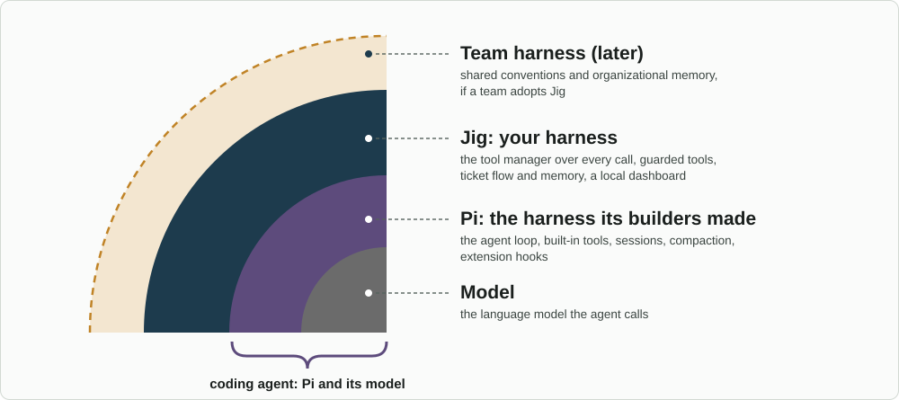
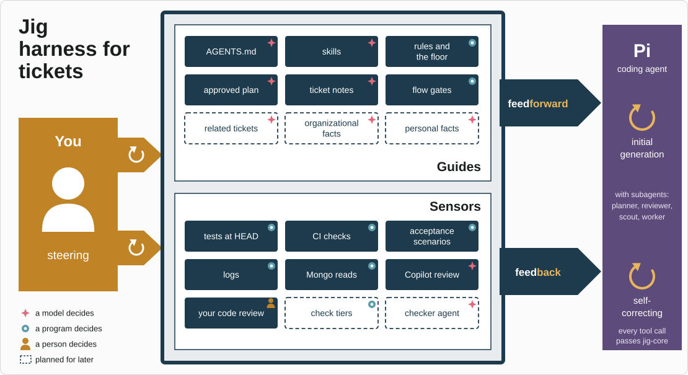
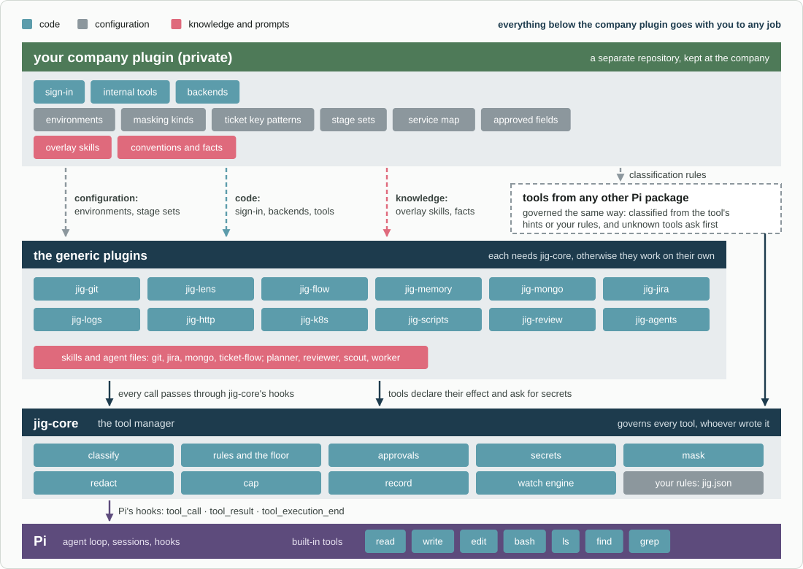

# Jig

[](https://github.com/Dev-Mriganka/jig/actions/workflows/ci.yml)

Jig is a set of plugins for the [Pi](https://pi.dev) coding agent. They decide
what the agent may do, ask you when it matters, keep secrets out of its reach,
and record what happened so you can see it later.

**Status:** eleven of the fourteen plugins are built, and `jig-sandbox` is being built. Each plugin's README is the
specification that its code follows. New to a word? See the [glossary](docs/glossary.md).

## What works today

In short:
- **Safety:** [`jig-core`](plugins/jig-core/README.md) governs every tool call.
  It applies rules per environment, asks you when a rule says so, keeps secrets
  out of the model's reach and masks production results. Pi's own file tools
  cannot read your credential folders or change Pi's settings.
- **Sign-in:** Jig never signs in. A credential comes from where you already keep
  it: an environment variable, a password manager, a command such as
  `gh auth token`, or a company's sign-in service. `jig-core` attaches it to the
  request, and no plugin sees its value.
- **Code:** `jig-git` (git, pull requests, releases), `jig-review` (a code
  review in the browser, approved with a passkey) and `jig-ops` (CI, deploy and
  what runs, from one service catalog).
- **Other systems:** `jig-jira`, `jig-logs` (Elasticsearch, OpenSearch, Loki),
  `jig-api` (your saved API requests, run by name) and `jig-mongo` (MongoDB, with
  allow and deny lists).
- **Seeing and remembering:** `jig-lens` shows cost, failures and the time spent
  waiting for you. `jig-memory` keeps a folder of notes and evidence per ticket.
- **How Pi looks:** `jig-theme` gives six palettes, a one-line footer and your
  own colours.
- **Checked on every push:** the type check, Biome, over 5,000 tests, the
  review page's build and every link in these docs run on GitHub Actions.

Being built: [`jig-sandbox`](plugins/jig-sandbox/README.md), which runs the
agent's `bash` in an operating-system sandbox. Designs: `jig-workflow` and
`jig-agents`.

## Install

Jig needs Pi 1.4 or later and Node.js 22.19 or later.

```bash
pi install git:github.com/Dev-Mriganka/jig
```

Then start Pi and run `/jig`: it shows the rules in force and anything that
needs fixing. Each plugin's README says what it needs in `~/.pi/agent/jig.json`
and which programs it uses, such as `git` and `gh` for `jig-git`.

To load only some plugins, filter the package in Pi's settings. Keep `jig-core`
first in the list, because every other plugin needs it:

```json
{
  "packages": [
    {
      "source": "git:github.com/Dev-Mriganka/jig",
      "extensions": ["plugins/jig-core/src/index.ts", "plugins/jig-git/src/index.ts"]
    }
  ]
}
```

## Where Jig sits



*Three harnesses, one inside the other, in [Birgitta Böckeler's](https://martinfowler.com/articles/harness-engineering.html) terms: the model is what gets harnessed, Pi's builders made the inner harness, and Jig is yours. A team harness would be the next ring if a team adopts Jig, and shared organizational memory would live there.*

## How Jig steers the agent



*Guides go forward into Pi before it acts, sensors feed back after it acts, and you steer by changing both. A star marks a model deciding, a dot a program, a figure a person, and a dashed outline something planned for later.*

## The plugins

| Plugin | Status | What it gives you |
|---|---|---|
| [`jig-core`](plugins/jig-core/README.md) | built | The tool manager: rules per environment, approvals, secrets, masking, watches, records |
| [`jig-sandbox`](plugins/jig-sandbox/README.md) | building | The agent's `bash` in an operating-system sandbox: credentials hidden, start-up files locked, everything else as outside |
| [`jig-git`](plugins/jig-git/README.md) | built | Local git, GitHub pull requests and reviews, tags and releases |
| [`jig-lens`](plugins/jig-lens/README.md) | built | Cost, tool failures and time spent waiting for you, inside Pi; Grafana optional |
| [`jig-workflow`](plugins/jig-workflow/README.md) | design | Named workflows you define: stages, exit conditions, holds, test runs |
| [`jig-memory`](plugins/jig-memory/README.md) | built | Ticket folders, notes and evidence; later, recall of related tickets |
| [`jig-mongo`](plugins/jig-mongo/README.md) | built | MongoDB: explore, query, aggregate and write, with allow and deny lists |
| [`jig-jira`](plugins/jig-jira/README.md) | built | Jira issues: read, comment, transition, update, with rendered previews |
| [`jig-logs`](plugins/jig-logs/README.md) | built | Log search over Elasticsearch, OpenSearch or Grafana Loki |
| [`jig-api`](plugins/jig-api/README.md) | built | Your saved API requests (Postman, Bruno, `.http`, OpenAPI), run by name |
| [`jig-ops`](plugins/jig-ops/README.md) | built | CI, deploy and runtime from one service catalog; watches CI until it ends |
| [`jig-review`](plugins/jig-review/README.md) | built | Code review in the browser, answered round by round, approved with a passkey |
| [`jig-theme`](plugins/jig-theme/README.md) | built | Six palettes as Pi themes, your own, a one-line footer, the answer colour |
| [`jig-agents`](plugins/jig-agents/README.md) | design | Subagents in terminal panes |

Every plugin needs `jig-core`; otherwise they work on their own.



*What lives where. Everything below the company plugin goes with you to any job; the company plugin stays private and only configures the generic plugins or adds backends and knowledge to them.*

**Company parts never go into this repository.** A company's environment
names, sign-in service, internal tools and backends live in a private company
plugin, so these generic plugins can go with you to any job.

[Plugins](docs/plugins.md) shows, for every tool, what is generic and what the
company plugin supplies, and the order of building.

## Read in this order

1. [Architecture](docs/architecture.md): how the tool manager sits over every
   tool, what it can and cannot control, and where each plugin fits.
2. [Permissions](docs/permissions.md): environments, rules per tool, and the
   floor that configuration cannot lower.
3. [Approvals](docs/approvals.md): how and where you are asked.
4. [Secrets](docs/secrets.md): where passwords and tokens come from, on any
   operating system.
5. [Plugins](docs/plugins.md): every tool and the plugin it belongs to.
6. [Decisions](docs/decisions.md): what was decided, what was rejected, and why.
7. [Glossary](docs/glossary.md): the terms these documents use.
8. [Writing the docs](docs/writing.md): how these pages are written, if you
   add to them.

## Relationship to the existing harness

Jig is built clean, beside the harness the author uses every day today:
- **It does not modify that harness.**
- **It ports what works.**
- **That harness keeps running** until each Jig plugin can replace its part.
