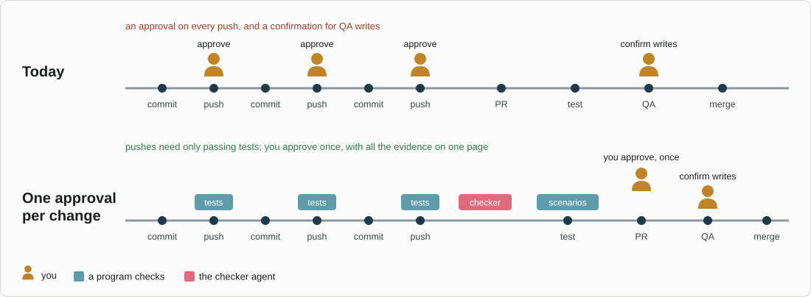

# Approvals

When a rule says **ask**, `jig-core` asks you inside the tool call that is
waiting. Your answer is what lets the call run.

## The one rule

**You approve inside the waiting call; the browser only shows.**

An approval given inside the waiting call cannot be forged or replayed: no token
exists that the agent could reuse. A browser button would be a web endpoint on
this machine, and the agent's shell shares the network with it. An earlier
code-review page had exactly that weakness: its link reached the agent.

So the browser can render long text for you to read, and you approve with `y`
in Pi.

### The one exception: a review approved in its page with a passkey

A code review is long and waits for you across many turns, and its page is where
you read it. [`jig-review`](../plugins/jig-review/README.md) therefore lets you
approve there, because a **passkey** proves that you are present, and the agent
cannot make one:

- Your device (Windows Hello, Touch ID or a security key) checks you and signs a
  fresh challenge, which the server issued for this review and as it is now. The
  server checks the signature against a key you registered. A request from the
  page without that signature approves nothing, whatever cookie it carries.
- A key is registered only after Pi shows its fingerprint and you answer `y`
  there, so adding a key is itself an approval inside a waiting call.
- The keys are in Pi's agent folder, which the agent's shell does not write.
- With no passkey, or no browser support, the page marks the review "approved in
  page" and Pi asks you `y`. It counts only after `y`, which is the rule above
  with the page as the place you pressed the button.

This is the only approval that does not ask in Pi, and the only web endpoint
that approves. It holds because the endpoint checks something the agent cannot
supply, not because its address is secret.
([Passkeys](../plugins/jig-review/docs/passkeys.md) has the checks.)

## Three kinds of question

| Kind | When | What you see | How you answer |
|---|---|---|---|
| Dialog | short, one-line confirmations | the action in one line | `y` or `n` |
| Review screen | long previews: diffs, Jira text, PR descriptions | a scrollable, coloured preview; `o` opens it rendered in the browser | `y` approves, `n` or Esc declines |
| Form | decisions with more than yes or no, such as choosing an option or filling a field | several questions on one screen, with options and free text | submit or cancel |

A rule can choose which kind its calls use. For example, Jira comments use
the review screen with a rendered preview.

The form screen will be built on `@adeildo/pi-ask-questions`, on trial. It is a
deliberate port of `@juicesharp/rpiv-ask-user-question`'s question format into a
framed dialog, and its README says other packages can open it. If it does not
hold up, Pi's own select and input dialogs take its place (see
[Reuse](reuse.md)).

In the first version the form kind is shown with Pi's own selector, like a
dialog. The dedicated form screen comes later.

Browser forms are not used for approvals: they answer through a local server,
which the agent's shell can reach. The exception above is not a form: it needs
a signature that only your device can make.

## Answers beyond yes and no

- **Decline with a reason.** After `n` you can type why, and the model reads
  it.
- **Allow for this session.** An ask for that tool, action and environment
  becomes allow until the session ends. It never reaches past the floor.

## One dialog at a time

Pi has a single dialog slot and does not arbitrate between packages. `jig-core`
queues its own questions. A clash with another package's dialog, such as a
question the model asks while a call waits, is a known limit.

## Rendered previews

Rich text is shown rendered before it is sent. That covers:
- Jira comments, descriptions and new issues;
- GitHub PR descriptions and PR comments.

The source is always one tab away. Status changes, field updates and deploys
keep the short dialog.

## What is recorded

Every question asked:
- which tool and action;
- which kind of question;
- your answer;
- how long the call waited for you.

That makes "time spent waiting for you" and "how often you were asked" visible
in `jig-lens`.

## One approval per change

*The same ticket under two rules: today each push asks, because the approval must cover the exact commit; with `jig-workflow`, pushes need only passing tests and you approve once, with all the evidence on one page, before teammates see the pull request. Writes to a test environment such as `staging` still ask you.*

## Later

- **A "waiting for you" list across sessions,** for when you work on one
  ticket while another waits.
- **Approving from another session.** Still inside a waiting call, never through
  the browser.
