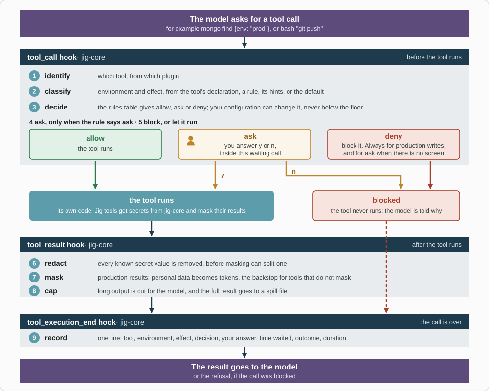

# Architecture

## The idea

One plugin, `jig-core`, manages every tool the agent can call, whoever wrote
it. The covered tools are:
- Pi's own: `read`, `write`, `edit`, `bash`, `ls`, `find`, `grep`;
- Jig's own tools;
- tools from any other package.

For each call, `jig-core` does five things:
- works out where the call acts and whether it reads or writes;
- applies your rules;
- asks you when a rule says so;
- masks what must not reach the model;
- records what happened.

The tools themselves come from other plugins, such as `jig-git`. They only
describe what they do; they never implement safety themselves.

This works because Pi lets one extension take part in every tool call, through
hooks that run in this order for each call (Pi's `docs/extensions.md`):

```text
tool_execution_start → tool_call → tool_execution_update → tool_result → tool_execution_end
```

- A `tool_call` handler can **block** a call, **change** its input, or **ask**
  the user first. Pi's documentation shows exactly this: a handler that asks
  "Allow tool call?" based on the tool's hints.
- A `tool_result` handler can **replace** a result before the model sees it.
  That is where masking happens.
- `tool_execution_end` reports the tool name, whether it failed, its duration,
  and its parent call. That is where the record is written.
- Calls one tool makes through another (`ctx.executeTool`) pass through the
  same hooks, so nothing is ungoverned.

## One call, end to end



*Every call passes through the same three hooks. A call that is denied, or that you decline, never runs; what does run has its result masked, redacted and capped, and every call is recorded.*

<details>
<summary>Text version</summary>

```text
 the model asks for a tool call        e.g. mongo find {env: "prod"}, or bash "git push"
        │
        ▼
 tool_call hook ─ jig-core
   1. identify   which tool, from which plugin
   2. classify   environment + effect (read or write)
                   from: the tool's own declaration (Jig tools)
                         or a rule in your configuration (any tool)
                         or the tool's hints (read-only, destructive, reaches outside)
                         or a default (unknown tools count as writes outside)
   3. decide     the rules table → allow / ask / deny
                   your configuration can always make it stricter,
                   but never lower the floor (see Permissions)
   4. ask        only when the rule says ask: the approval screen,
                   inside this waiting call (see Approvals)
   5. block, or let it run
        │
        ▼
 the tool runs ─ its own code
   Jig tools fetch secrets through jig-core and mask their own results
        │
        ▼
 tool_result hook ─ jig-core
   6. mask       production results: personal data becomes tokens
                   (the backstop for tools that do not mask themselves)
   7. redact     every known secret value is removed
   8. cap        long output is cut, and the full result goes to a spill file
        │
        ▼
 tool_execution_end ─ jig-core
   9. record     one line: tool, environment, effect, decision, your answer,
                 how long it waited for you, outcome, duration, parent call
        │
        ▼
 the result goes to the model
```

</details>

## What the tool manager can and cannot control

| It can | It cannot |
|---|---|
| Stop any call before it runs, and ask you first | See what a tool does inside its own code. A third-party tool that writes to production without saying so looks like any other call |
| Mask and redact any result before the model sees it | Un-send data a tool already sent somewhere |
| Record every call of every tool | Know the environment of a `bash` command. A shell string can reach anything |

What closes those gaps:

- **Unknown tools are treated as writes outside the machine,** so they ask
  until a rule or the tool's own hints say otherwise.
- **`bash` runs in a sandbox** that hides credentials. Without credentials, a
  shell command cannot do much harm outside the machine. The sandbox is the
  protection; command rules for `bash` are a convenience on top. While Jig is
  tried beside the existing harness, it borrows that harness's sandbox (see
  Decisions).
- **Remote actions go through tools,** not through `bash`. Jig's tools hold the
  credentials, so the tool manager sees, decides and records every remote
  action.

## Where things live

```text
jig (this repository, generic)
  jig-core   tool manager: classify, rules, approvals, secrets, mask, redact, cap, record; watch engine
  jig-git    tools: local git, GitHub PRs and reviews, CI checks and watching
  jig-lens   observability: reads jig-core's records, local dashboard
  jig-flow, jig-memory, jig-mongo, jig-jira, jig-logs, jig-http, jig-k8s,
  jig-scripts, jig-review, jig-agents   (see Plugins)

company plugin (separate, private repository)
  the company's environments, sign-in service, internal tools and backends
```

- **Plugins talk through `jig-core`,** never to each other's files.
  `jig-core` publishes the shared contracts:
  - how a tool declares what it does;
  - the record format;
  - the events other plugins can listen to.
- **One owner per file:** only `jig-core` writes the records, and `jig-lens`
  only reads them.

## Platforms

Jig is TypeScript on Node, as Pi is, so it runs on Linux and macOS.
- **The sandbox is the exception.** Bubblewrap is Linux-only, so macOS needs
  its own sandbox later. That is the real work for a Mac, not passwords.
- **Secrets have a backend per platform** (see Secrets).
