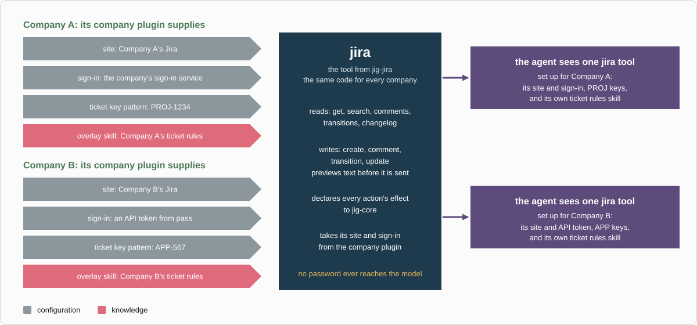

# Plugins: every tool, and where it goes

This is the map of every tool the agent uses and the plugin it belongs to.
Generic plugins live in this repository and go with you to any job. Company
parts live in a private company plugin kept at the company.

*What lives where. Everything below the company plugin goes with you to any job; the company plugin stays private and only configures the generic plugins or adds backends and knowledge to them.*

## Tools that need no plugin

| Tool | Where it comes from | How Jig handles it |
|---|---|---|
| `read`, `ls`, `find`, `grep` | Pi | `jig-core` default: local read, allowed |
| `write`, `edit` | Pi | `jig-core` default: local write, allowed |
| `bash` | Pi | `jig-sandbox` runs it in the sandbox; allowed, with optional command rules. Run outside the sandbox, it asks |
| `ask_user_question` | `@juicesharp/rpiv-ask-user-question` | Allowed, so a question never asks first |
| Tools from any other package | That package | Classified from the tool's hints or your rules; unknown tools ask |

`@adeildo/pi-ask-questions` is the nicer-looking question tool, and Jig's forms
build on it (see [Reuse](reuse.md)). Pi's file tools also refuse protected
paths (see [Permissions](permissions.md#the-floor-what-configuration-cannot-change)).

## Generic plugins (this repository)

| Plugin | Status | Tools | Order |
|---|---|---|---|
| [`jig-core`](../plugins/jig-core/README.md) | built | `watch`; the tool manager and the `/jig` commands | 1 |
| [`jig-git`](../plugins/jig-git/README.md) | built | `git`, `pr`, `release` | 2 |
| [`jig-lens`](../plugins/jig-lens/README.md) | built | none: the `/lens` command | 2 |
| [`jig-sandbox`](../plugins/jig-sandbox/README.md) | built, in part | `bash` (replaces Pi's), `bg_output`, `bg_list`, `bg_kill`; the `/sandbox` and `/ps` commands | 2 |
| [`jig-workflow`](../plugins/jig-workflow/README.md) | design | `workflow` | 3 |
| [`jig-memory`](../plugins/jig-memory/README.md) | built | none: ticket folders, cards, recall and the `/ticket` command (`close`, `recall`) | 3 |
| [`jig-mongo`](../plugins/jig-mongo/README.md) | built | `mongo` | 4 |
| [`jig-jira`](../plugins/jig-jira/README.md) | built | `jira` | 5 |
| [`jig-logs`](../plugins/jig-logs/README.md) | built | `logs` | 6 |
| [`jig-api`](../plugins/jig-api/README.md) | built | `api`; the `/api refresh` command | 7 |
| [`jig-ops`](../plugins/jig-ops/README.md) | built | `ci`, `deploy`, `runtime` | 7 |
| [`jig-review`](../plugins/jig-review/README.md) | built | `start_interactive_code_review` and one more; `/code-review` | 8 |
| [`jig-theme`](../plugins/jig-theme/README.md) | built | none: the `/theme` command, palettes and a footer | 8 |
| [`jig-agents`](../plugins/jig-agents/README.md) | design | `subagent` and five more | 8 |

`jig-agents` is built only if a package from the Pi store does not do the job
better. Each plugin's README has the full table of its tool's actions.

## The actions of every tool

- **`watch`** (`jig-core`): `list`, `stop`.
- **`git`:** `status`, `diff`, `log`, `show`, `blame`, `branches`, `fetch`,
  `clone`, `branch`, `worktree`, `commit`, `stash`, `sync`, `merge`, `rebase`,
  `cherry_pick`, `restore`, `push`.
- **`pr`:** `view`, `list`, `comments`, `create`, `edit`, `ready`, `comment`,
  `reply`, `resolve`, `review`, `merge`.
- **`release`:** `tags`, `releases`, `tag_create`, `tag_push`, `release_create`.
- **`workflow`** (design): `list`, `status`, `start`, `bind`, `submit-plan`,
  `test`, `scenario`, `advance`.
- **`mongo`:** `databases`, `collections`, `schema`, `stats`, `indexes`,
  `index-stats`, `explain`, `count`, `find`, `distinct`, `sample`, `aggregate`,
  `insert`, `update`, `replace`, `delete`, `bulk`, `create-index`, `drop-index`.
- **`jira`:** `get`, `search`, `comments`, `transitions`, `changelog`,
  `attachments`, `assignable`, `find_field`, `create`, `comment`,
  `edit_comment`, `delete_comment`, `transition`, `update`.
- **`logs`:** one search, by phrase or query, with a time window, filters and
  paging.
- **`api`:** `list`, `show`, `run`, `run-folder`, `call`.
- **`ci`:** `status`, `runs`, `run`, `log`, `rerun`, `trigger`, `watch`.
- **`deploy`:** `plan`, `run`, `status`, `rollback`, `watch`.
- **`runtime`:** `pods`, `rollout`, `logs`, `events`, `health`.
- **`start_interactive_code_review`, `record_interactive_review_resolution`**
  (`jig-review`).
- **`subagent`, `subagent_message`, `subagent_status`, `subagent_interrupt`,
  `subagent_done`, `caller_ping`** (`jig-agents`, design).

`jig-ops` has one adapter per system: `ci` has GitHub Actions, GitLab CI and
Jenkins, `deploy` has Helm and `kubectl set image`, and `runtime` has
Kubernetes. `jig-git` keeps git, pull requests, reviews and releases. CI and the
watch that waits for it are in `jig-ops`, and the two meet in one event,
`jig-git:pushed`.

## What a company plugin supplies

Each generic plugin has a company part. It is configuration and knowledge,
never code that changes the tool:
- **`jig-core`:** environments, classification rules, extra field names for
  masking, sign-in services, transports, secret commands and protected paths.
- **`jig-git`:** the GitHub organization, branch names, protected branches and
  the pull request template.
- **`jig-lens`:** names for the models in `/lens usage`, through the
  `jig-lens:model-names` event.
- **`jig-workflow`:** its workflow files, the ticket key patterns they match
  and its acceptance environments.
- **`jig-memory`:** ticket key patterns and the folder's location.
- **`jig-mongo`:** its connections and routes (for example a tunnel through its
  own jump hosts), its production allow lists and secret references.
- **`jig-jira`:** the Jira site and its sign-in.
- **`jig-logs`:** the log backend, its type and address, indexes or selectors,
  environment names and sign-in.
- **`jig-api`:** where its collections live, how their environments map, and a
  transport or sign-in service for APIs it reaches through one.
- **`jig-ops`:** the service catalog, its CI servers and sign-in, its deploy
  methods, the "artifact ready" rules and transports.
- **`jig-review`:** nothing.
- **`jig-theme`:** a company palette, footer defaults and footer parts of its
  own, such as a model spend.
- **`jig-agents`:** which model each role uses.

## How company parts plug in

*The difference between companies is configuration and knowledge, not code: each company plugin supplies its own site, sign-in, ticket key pattern and an overlay skill, which is its own rules added to the plugin's skill. The `jira` tool stays the same.*

## What stays in the company plugin

Some tools exist only because of one employer, and never come into this
repository:
- internal databases and billing systems;
- a company deploy tool and its pipelines (for example, one that deploys a
  built image to `staging` after CI passes);
- the model provider account and budget;
- the sign-in service;
- scripts that need credentials or production access, as company tools.
  Everyone else runs scripts with `bash`, in the sandbox.

A CI system is generic, so it is an adapter of `jig-ops`: GitHub Actions,
GitLab CI and Jenkins are built, and Buildkite or CircleCI would be one more
file. A system that only one employer uses, or that is reachable only through a
company's sign-in, comes as a sign-in service or a transport from the company
plugin.

## Order, and why

The numbers in the table above follow this order:
- **1. `jig-core`:** everything else needs it.
- **2. `jig-git` and `jig-lens`:** git is the first real tool, and the records
  show from the first day what it costs and how often it fails.
- **3. `jig-workflow` with `jig-memory`:** workflows carry the fixes that matter
  most: trustworthy checks, one approval per change, and review before anything
  is shared.
- **4 to 7. The data and service tools,** one at a time, each with its company
  part: `jig-mongo`, `jig-jira`, `jig-logs`, then `jig-api` and `jig-ops`.
- **8. Review, `jig-theme` and subagents.** Nothing depends on them, so they can
  come at any point, and subagents are skipped if a package from the Pi store
  does the job better (see [Reuse](reuse.md)).
