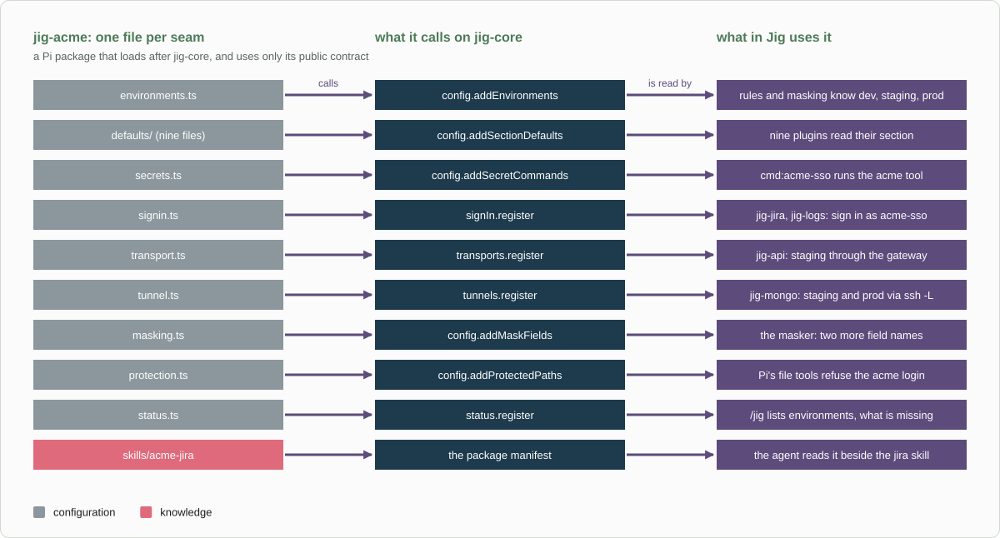

# jig-acme: an example company plugin

**Status: example, built.** Tested against fakes with the real `jig-core` and every built Jig plugin loaded into a fake Pi. Acme
Corp is made up; nothing here has been tried against a real Jira, log cluster, database or bastion.

`jig-acme` is what a company adds to Jig so that the generic plugins work at that company. It proves the generic plugins need no
company code, and it is a template: copy it, rename it and replace the values. It uses only Jig's public contract, through the
global handle, and adds no behaviour of its own to any tool.

For example, with this plugin loaded, a user who writes one line gets a working Jira, logs, databases and a deploy catalog:

```json
{ "acme": { "bastion": { "user": "jdoe" } } }
```



*One file per seam. Each file calls one thing on `jig-core`, and something in Jig reads the result. Grey is configuration, pink is
knowledge, an overlay skill the agent reads.*

## The parts

| File | What it gives Jig | What a real company puts there |
|---|---|---|
| [`src/environments.ts`](src/environments.ts) | `dev` and `staging` (test), `prod` (production) | The names its tools and logs use, and which hold live customer data |
| [`src/defaults/`](src/defaults) | Defaults for nine plugins' sections: jira, logs, mongo, api, ops, memory, git, theme, sandbox | Where its systems are, and its conventions |
| [`src/secrets.ts`](src/secrets.ts) | The command `acme-sso`, which `cmd:acme-sso` runs | The command-line tool that owns its login |
| [`src/signin.ts`](src/signin.ts) | The sign-in service `acme-sso`: a bearer header from a secret reference | Whatever its gateway wants: a token, an HMAC, a cloud signature |
| [`src/transport.ts`](src/transport.ts) | The transport `acme-gateway`: a request carried by a gateway on this machine | A sign-in proxy, a VPN gateway's API, a browser-session broker |
| [`src/tunnel.ts`](src/tunnel.ts) | The tunnel `acme-bastion`: `ssh -L`, a forward | A jump host, a cloud port forward, a VPN client's command |
| [`src/masking.ts`](src/masking.ts) | Two field names for the masker: `memberAlias`, `loyaltyCardHolder` | The names that hold personal data in its own systems |
| [`src/protection.ts`](src/protection.ts) | One secret path: `~/.acme/credentials.json` | Where its own tools keep a login |
| [`src/status.ts`](src/status.ts) | Lines for `/jig`: the sign-in, transport and tunnel it adds, and what this user still has to set | What a user needs to see at a glance |
| [`skills/acme-jira`](skills/acme-jira/SKILL.md) | The company's Jira conventions, read beside the `jira` skill | Its projects, fields, workflow and manners |
| [`src/config.ts`](src/config.ts) | The `acme` section of `jig.json`, for what only one person can say | The few per-person settings |
| [`src/hosts.ts`](src/hosts.ts) | The hosts the sign-in service and the transport serve, and no others | Its own hosts, so a credential never goes where somebody else chose |
| [`src/jig/`](src/jig) | The global handle and the contract's types | A copy of `client.ts`, and the types from a checkout of Jig |

[`src/index.ts`](src/index.ts) calls each of them from one `withJig` callback, so it does not matter whether Pi loads this package
before `jig-core` or after it.

## Rules

- **Public contract only.** `src/jig/client.ts` is a copy of `jig-core`'s lookup, because a separate package cannot import its
  modules; a test fails when the copy differs. Types come from `contract.ts` with `import type`.
- **Configuration and knowledge, never a change to a tool.** A tool gets another site or another sign-in, not another behaviour.
- **No credential in the code.** A secret is a reference (`env:`, `pass:`, `cmd:`); a value pasted in its place is refused, and
  the message does not repeat it. The company's own tool owns the login.
- **The floor holds.** `prod` is read-only and masked whatever this plugin says, and a protected path can only be added.

## Configure

In `~/.pi/agent/jig.json`. Everything is optional, and each plugin's own section is laid over the company's defaults, so a user
writes only what they change (see [Writing a company plugin](../../docs/company-plugin.md#how-your-jigjson-layers-over-the-defaults)).

| Field | Default | Meaning |
|---|---|---|
| `acme.sso.token` | `cmd:acme-sso` | The secret reference the sign-in service reads its token from |
| `acme.gateway.proxy` | `http://127.0.0.1:3128` | The gateway's address: plain http, on this machine only |
| `acme.bastion.host` | `bastion.acme.example` | The bastion host |
| `acme.bastion.user` | none | Your login on the bastion, which only you know. `/jig` says when it is missing |

A company plugin cannot turn a secret backend on, so each user turns on the one they use. The default token comes from the
`acme` command, which needs `cmd`; a token in a variable needs `env`:

```json
{ "secrets": { "backends": ["pass", "cmd"] }, "acme": { "bastion": { "user": "jdoe" } } }
```

## Copy it for a real company

1. **Copy the folder** to a repository of your own and rename `jig-acme` in `package.json`, the code and the skill. Keep the
   repository private.
2. **Replace the values** in `src/environments.ts` and `src/defaults/`, one plugin at a time. Delete the files you have no use for,
   and their lines in `src/index.ts`.
3. **Point `src/jig/types.ts` at Jig.** Here it is a relative path inside this repository; link a checkout of Jig next to yours (a
   `.jig` folder) and re-export from it, as [Writing a company plugin](../../docs/company-plugin.md#test-it-the-way-jig-acme-does) shows.
4. **Replace the sign-in, transport and tunnel** with the code your company needs, or delete them.
5. **Run the tests** and change them with the values. The tests name each rule they check.

## Layout

```text
jig-acme/
  package.json        the manifest: pi.extensions and pi.skills
  src/                index.ts and one small file per seam; defaults/ has one file per plugin; jig/ is the handle
  skills/acme-jira/   the overlay skill
  test/               the real plugins in a fake Pi, and fake servers and programs; support/ has the loaders
```

## More detail

- [Writing a company plugin](../../docs/company-plugin.md): what goes in one, the seams in order, layering, testing, keeping it private
- [Plugins](../../docs/plugins.md#what-a-company-plugin-supplies): what each generic plugin takes from a company plugin
- [Plugin contract](../../plugins/jig-core/docs/plugin-contract.md) and
  [credential sources](../../plugins/jig-core/docs/sign-in-and-transports.md): the calls this plugin makes
