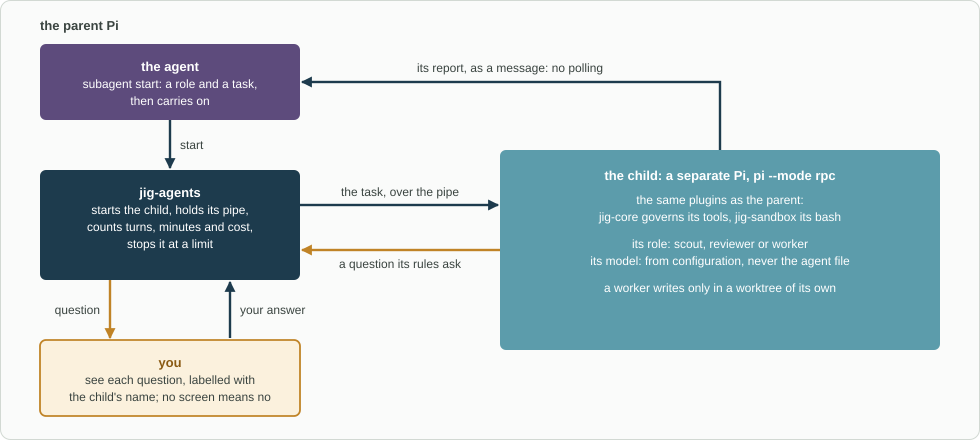

# jig-agents: child agents that Jig's rules still govern

**Status: built.** Tested with a fake child that speaks Pi's RPC protocol, and with the stock Pi 1.4 as a real child
(this repository's `jig-core` and `jig-agents`, on Pi's own scripted model). No model is called; what only
a real one can show is in [Not verified](docs/not-verified.md).

`jig-agents` lets the agent hand work to **child agents**. A child is a separate Pi process that loads the
same plugins as its parent, so `jig-core` governs its tool calls and `jig-sandbox` its `bash`.

When a child's rules say "ask", the question comes to your screen, labelled with the child's name, and your
answer goes back. Each child has limits on turns, minutes and cost, and its report reaches the parent
without polling.

For example, the agent starts a `scout` with the task "find where `orders-api` rounds order totals" and carries
on. When the scout finishes, its report arrives as a message.



*How a child runs. The child is a full Pi with the same plugins, so Jig's rules govern it; its questions come to you through the parent, and its report comes back without polling.*

## The decision

Jig builds this plugin itself, on Pi's own RPC mode, and adopts no package: none of the Pi store's subagent
packages keeps every child under `jig-core` and `jig-sandbox`, brings its questions to your screen, and limits
turns, time and cost. See [Options](docs/options.md) and
[the decision](../../docs/decisions.md#2026-10-31-jig-agents-is-built-by-us-on-pis-rpc-mode).

## Tool: `subagent`

| Action | Kind | What it does |
|---|---|---|
| `start` | local write | Starts a child from a role and a task, and returns at once |
| `status` | read | This session's children: state, turn, minutes, cost, questions waiting |
| `message` | local write | Steers a running child, or resumes a finished one in a new process |
| `stop` | local write | Stops a child and returns its partial report |

`start` takes a `role`, a `task`, and optionally a `name` and a `cwd` inside the parent's folder. It takes no
model and no tool list: those come from the role and configuration.

| Command | What it does |
|---|---|
| `/agents` | The children of this session and any problem; `/agents roles` lists the roles |
| `/agents show <id>` | The last lines of a child's transcript |
| `/agents say <id> <text>`, `/agents stop <id>` | `message` and `stop`, typed by you |

## Roles and agent files

A **role** is an agent file: Markdown with a name, a description the parent agent reads, the tools the child
may use, and a prompt. Three ship with the plugin.

| Role | May write | For |
|---|---|---|
| `scout` | no | Exploring code, logs and tickets; reports findings with evidence |
| `reviewer` | no | Reviewing a diff or branch with fresh eyes; changes nothing |
| `worker` | yes | One scoped change, in a worktree of its own, tested |

```markdown
---
name: scout
description: Read-only exploration of code, logs and tickets, with evidence
tools: read, grep, find, ls, git, logs
writes: false
---

You explore and report. Every claim cites a file and line, a log line or a ticket key.
```

- **No model and no limits in the file.** They come from [configuration](#configure), so a public agent file
  never names a company's model.
- **`tools` only narrows.** A role that does not write needs a `tools` list without `bash`, `write` or `edit`.
- **A worker gets a worktree:** a new folder beside the repository, on a new branch, made through `jig-core`'s
  git. The report names the branch.
- **Read from three places:** the plugin's `agents/`, `agents.folders`, and `~/.pi/agent/agents/`. Never from the
  project, because the model can write there. A bad file is skipped, and `/agents roles` names it and the field.

## Approvals in a child

A child asks through `jig-core` as its parent would. Pi's RPC mode turns the child's dialog into a request on
its output. The parent shows it on your screen, one at a time and behind `jig-core`'s own questions, under a
line the plugin writes (`Subagent "scout-2" (scout) asks.`), and sends your answer back by the request's random
id on a pipe only the parent holds. The agent cannot answer for itself: the pipe is not a file or a web endpoint.

- **Every failure is a no.** No screen, no answer within `approvalWaitMinutes`, more than `maxAsks` questions,
  or a request the plugin cannot read: the question is cancelled, and the child's `jig-core` counts that as a
  decline.
- **The floor is decided in the child.** A yes only settles what the child's own rules left as "ask".
  "Allow for this session" is shown as "Allow for this subagent" and ends with that child. A role set to
  `approvals: "deny"` never forwards.

[Design](docs/design.md#approvals-in-a-child) has the path, the checks and the attacks considered.

## Limits

| Limit | Default | How it is counted |
|---|---|---|
| `maxTurns` | 40 | The parent counts the child's finished turns |
| `maxMinutes` | 30 | Wall clock, not counting time spent waiting for you |
| `maxCost` | 2 | US dollars Pi reports for the child, checked after each turn |

At a limit the child is told to write its report from what it has, gets two more turns or minutes, and is
then aborted. The report says which limit stopped it. Cost is bounded only for a model that Pi prices, and
there is no "no limit" setting.

## Rules

- **Never fewer extensions.** The plugin never passes `--no-extensions` or `-e`, and stops a child that does
  not list `jig-core`'s commands before it gets its task.
- **One writer per folder,** in a worktree other than the parent's.
- **No orphans.** A child ends with its parent session, for any reason; one left by a parent that died is
  stopped at the next session start.
- **Few children.** `maxRunning` (4) at once, `maxStarted` (30) per session, none started by a child.

## Configure

In `~/.pi/agent/jig.json`, under `agents`. Every field is optional.

| Field | Default | Meaning |
|---|---|---|
| `roles.<role>.model` | the parent's | `provider/id`, with `:thinking` if wanted; checked against `enabledModels` |
| `roles.<role>.maxTurns`, `.maxMinutes`, `.maxCost` | `limits` | Limits for one role |
| `limits.maxTurns`, `.maxMinutes`, `.maxCost` | 40, 30, 2 | Limits for every role |
| `approvals`, `roles.<role>.approvals` | `forward` | `forward` or `deny` |
| `maxRunning`, `maxStarted`, `approvalWaitMinutes`, `maxAsks` | 4, 30, 30, 10 | Counts and waits |
| `folders`, `env` | none | More folders of agent files; extra variable names for children |
| `branch` | `agent/{name}` | The branch of a worker's worktree; `{name}` is the child's name |

An unknown field is an error, as in `jig-core`. A company plugin sets `roles.scout.model` and the like through
`jig-core`'s section defaults. [Design](docs/design.md#configuration) has the ranges.

## Company part (in the company plugin)

- which model each role uses, limits that fit its prices, a folder of its own roles (`agents.folders`) and the
  variable names its model provider needs in a child (`agents.env`), through `jig-core`'s section defaults;
- a hold in its workflow files on `subagent start`, such as until the plan is approved.

## Later

- **A live view:** an opt-in terminal pane that follows a child's transcript.
- **`ask_parent`:** a tool for a child to put a question to the parent agent.
- **A worktree made through `jig-git`,** and a **cost cap for the whole session**.

## Layout

```text
jig-agents/
  src/      index (factory), runtime + start-plan (the session's children; what a start works out), child (one child)
            with child-process, child-questions, child-report and child-types, rpc, forward (questions), limits,
            launch (flags, environment, model), roles, config, tool, commands, watch, worktree, store + orphans, host, clean
  agents/   scout.md, reviewer.md, worker.md; skills/subagent/SKILL.md: when to delegate
  test/     one file per module; world.ts runs a parent session with a fake child, real-pi.test.ts a real Pi
  docs/     the detail pages below
```

## More detail

- [Code map](docs/code-map.md): every file, who calls it, and a child followed from `start` to its report
- [Options](docs/options.md): the Pi store's packages compared, and what the earlier harness taught
- [Design](docs/design.md): launch, approvals, limits, results, roles, configuration, tests
- [Not verified](docs/not-verified.md): what only a real model run can show
