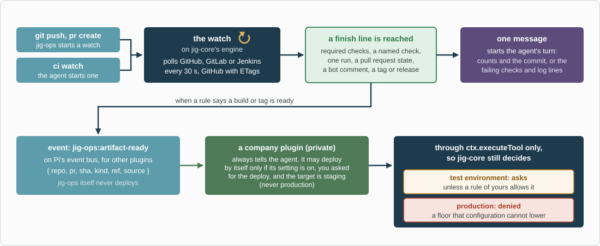

# jig-git: git, GitHub and CI

**Status: design.** This README is the specification; there is no code yet.

`jig-git` gives the agent four tools:
- `git`: the local repository;
- `pr`: GitHub pull requests and reviews;
- `checks`: GitHub checks and Actions, and watching them in the background;
- `release`: tags and releases.

The watches run on `jig-core`'s watch engine, and `jig-core`'s `watch` tool
lists and stops them.

Every tool declares the environment and effect of each action to `jig-core`.
Reads and local writes are allowed; writes to GitHub ask you.

The tool list comes from two sources:
- an inventory of two months of real sessions: about 26,000 tool calls, plus
  about 3,800 `git` and 200 `gh` commands run through `bash`;
- standard developer needs.

## What the sessions showed

- **Most of `git` and `pr` already exists** in the existing harness, which has
  run about 225 of these calls. It is ported, not redesigned.
- **What was missing is the wait.** Nothing watched GitHub CI, so you were the
  signal: about 15 "is it done?" nudges in one month. One build was ready 7
  minutes after the push and reached the agent 2 hours 16 minutes later.
- **"All checks done" is the wrong finish line.** Six background
  `gh pr checks --watch` runs never finished. In one pull request, two of ten
  checks were still pending 20 hours after the build the next step needed had
  passed.
- **The agent stops using `bash` for a job once a tool covers it.** `gh` calls
  through `bash` fell from 148 to 3 after the `pr` tool arrived.

## Tools

Default decisions:
- **read:** allowed;
- **local write:** allowed;
- **external write:** asks.

A rule in your configuration can change any of them, within the floor.

### `git`: the local repository

| Action | What it does | Default |
|---|---|---|
| `status` | Branch, upstream, ahead and behind the base, changed files. Every repository in the workspace when no `repo` is given | read |
| `diff` | Working tree, staged, a range `a..b`, or against the merge base; limited to paths; as a summary, file names or a patch | read |
| `log` | A range or paths, filtered by author, date or message, in a chosen format | read |
| `show` | A commit, or a file at a revision | read |
| `blame` | Who last changed each line | read |
| `branches` | Local and remote branches, their tracking, and which contain a commit | read |
| `fetch` | Branches and tags from the remote | read |
| `clone` | `owner/name` into a new folder, over SSH only | local write |
| `branch` | Create from the fetched base, switch, or delete a merged branch | local write |
| `worktree` | List, add or remove worktrees | read; adding and removing are local writes |
| `commit` | Exact paths and a message. Amend only while the commit is unpushed. Message rules come from configuration | local write |
| `stash` | Push, list, pop, drop | local write |
| `sync` | Fast-forward from the upstream | local write |
| `merge` | Merge the base or another branch; a conflict aborts cleanly | local write |
| `rebase`, `cherry_pick` | A conflict aborts cleanly; protected branches are refused. Built last: the sessions never used them | local write |
| `restore` | Discard changes in the listed paths | local write, but **asks** by default: it destroys uncommitted work |
| `push` | A branch. The preview lists the commits. Force only with lease, never to a protected branch. Tags go through `release` | external write |

### `pr`: pull requests and reviews

| Action | What it does | Default |
|---|---|---|
| `view`, `list` | State, draft, mergeable, review decision, checks and body; a list by state, author or branch | read |
| `comments` | The conversation, reviews and line comments, with full bodies and thread ids; filter by author or unresolved | read |
| `create` | A pull request from a pushed branch, from the body template. Returns the existing one if there is one | external write, on the review screen |
| `edit`, `ready` | Title, body, base, labels, reviewers; draft to ready | external write |
| `comment`, `reply`, `resolve` | A comment, a reply in a review thread, resolving a thread | external write; text goes on the review screen |
| `review` | Comment, or request changes. **Never approve:** approval stays human | external write |
| `merge` | Merge, squash or rebase, only while the head is still the commit you saw; or turn on auto-merge | external write |

### `checks`: GitHub checks and Actions

| Action | What it does | Default |
|---|---|---|
| `status` | The checks of a pull request, branch or commit; only the required ones if asked | read |
| `runs`, `run`, `artifacts` | Workflow runs by branch, commit or state; one run's jobs and steps; its artifacts | read |
| `log` | A failed job's log: the tail, or the lines matching a search; capped and redacted | read |
| `rerun` | The failed jobs, or the whole run | external write |
| `watch` | Starts a background watch on a pull request, branch, run, tag or release, with a finish line. Returns its id at once | local write |

`checks` covers GitHub only. Other CI systems belong in a company plugin (see
[Plugins](../../docs/plugins.md)).

### `release`: tags and releases

| Action | What it does | Default |
|---|---|---|
| `tags`, `releases` | Tags (the latest matching a pattern, or those containing a commit); releases, listed or one in full | read |
| `tag_create` | An annotated tag, locally | local write |
| `tag_push` | Push a tag | external write |
| `release_create` | A GitHub release | external write |

The sessions barely used tags and releases (one `git tag`, no `gh release`),
so these actions rest on standard practice.

### Left out on purpose

| Not offered | Why |
|---|---|
| Starting a workflow by hand | A workflow can deploy; deploys belong to a deploy tool with its own rules |
| A raw GitHub API tool | Its writes cannot be classified |
| Approving a pull request | Approval stays human |
| Deleting tags, `reset --hard`, `clean` | They destroy work and are rarely needed; you can run them yourself |

`git`, `pr` and `checks` are always loaded, and so is `jig-core`'s `watch`.
In the sessions, a "tool not found" cost the agent extra calls.

## Watching CI until it is done

A watch runs on `jig-core`'s watch engine, outside the sandbox, and the call
that starts it returns at once. `jig-git` supplies what to poll on GitHub and
when the watch is done.



*From a push to a wake-up: the watch polls GitHub until its finish line, one message starts the agent's turn, and an artifact-ready event may lead a company plugin to deploy, but only through `ctx.executeTool`, so `jig-core` still asks for a test environment unless a rule allows it, and denies production.*

1. **It starts by itself** after `git push` and `pr create` (setting
   `watch.auto`), or when the agent calls `checks watch`.
2. **Its finish line is explicit, never "all checks".** It can be:
   - the required checks;
   - a named check, such as the job that builds the image;
   - one run;
   - a pull request state, such as approved or merged;
   - a bot comment matching a pattern;
   - a tag or release matching a pattern.

   It stops at the first required failure. It sends a "still waiting" notice
   after 30 minutes and gives up after 60.
3. **It polls GitHub's API every 30 seconds, with ETags.** An unchanged answer
   (`304`) does not count against GitHub's rate limit, and the watch follows
   GitHub's `X-Poll-Interval` when GitHub sends one. A lost login gives one
   notice and pauses the watch; it never blocks a call.
4. **It sends one message per result, and the message starts a turn of the
   agent.**
   - When the watch passes: counts and the commit.
   - When it fails: the failing checks, their links, and the first lines of
     the failed log.

   Notices are combined when they arrive together, sent at least 10 seconds
   apart, and only one waits at a time.
5. **Open watches survive a restart.** They are saved in the state folder and
   resume when Pi starts, so a result that came while Pi was closed arrives as
   "finished while you were away".

### Knowing that a build or a tag exists

Rules in configuration say when an artifact is ready. They are tested when the
watched check ends, or when a comment or tag appears:
- a named job succeeded for the head commit;
- a version is read from that job's log, by a pattern that ends in the head's
  short commit id;
- a bot comment on the pull request matches a pattern;
- a new tag or release matches a pattern.

A version that does not contain the watched commit is ignored.

### Events

On Pi's event bus, for other plugins:
- `jig:watch-done`, from `jig-core`'s engine: a watch finished, with its
  result;
- `jig-git:artifact-ready`: `{ repo, pr, sha, kind: image | tag | release, ref, source }`.

### `jig-git` never deploys

What happens after "artifact ready" is a company decision. A company plugin may
listen for the event, and it always tells the agent. It may start a deploy by
itself only when all of these hold:
- its automatic deploy setting is on (off by default);
- the watch was started for a deploy you asked for;
- the target is the first shared test environment, and the deploy replaces no
  one else's build there.

The deploy goes through `ctx.executeTool`, so `jig-core` still decides:
- a write to a test environment asks, unless your rule allows it;
- production is denied.

Automation stops wherever a person must approve, such as a pull request that
needs a code owner.

## Ported from the existing harness

- **A table of parameters per action,** with errors that show the correct
  usage.
- **A hardened git runner.** git runs from an argument list, never a shell,
  with hooks, `core.fsmonitor` and prompts switched off. Before it runs in a
  repository, it refuses `.git/config` settings that would run a command, such
  as `credential.helper`, `diff.external`, `gpg.program` or `include.path`. The
  agent's shell can write that file, and the tool runs outside the sandbox with
  your credentials.
- **Preview, then run.** A write shows what it will do, and refuses if anything
  changed since the preview.
- **A lost reply is checked with one read, never retried.**
- **A closed grammar for what `clone` accepts.**
- **Check states mapped to pass, fail, pending and skipped.**
- **Pull request comments assembled with their line comments and threads.**

## Configure

In `~/.pi/agent/jig.json`, under `git`. All fields are optional; a company
plugin can set them for its repositories.

| Field | Default | Meaning |
|---|---|---|
| `base` | the repository's default branch | The branch new work starts from and pull requests target |
| `protected` | the repository's default branch | Branches that refuse a direct push, a force push, a rebase and a cherry-pick |
| `commitMessage`, `branchName` | none | Patterns that commit messages and new branch names must match |
| `prTemplate` | the repository's own template | The pull request body template |
| `watch.auto` | `true` | Start a watch after `git push` and `pr create` |
| `watch.pollSeconds`, `watch.stallMinutes`, `watch.timeoutMinutes` | 30, 30, 60 | Polling and limits |
| `artifacts` | none | The "artifact ready" rules: a check name, a log pattern, a bot and a comment pattern, or a tag pattern |

## Not in this plugin

- **Other CI systems** (for example Concourse or Jenkins), deploy tools and
  container registry checks. They belong in a company plugin.
- **Gates on commit and push,** such as "no push without a review". They are
  `jig-flow` rules, not git code.
- **A company's conventions,** such as branch names, protected branches and the
  pull request template. They are the settings above, set by the company
  plugin.

## Not verified yet

- **Pi's event bus and messages that start a turn** were checked against an
  older Pi (1.2), not 1.4.
- **Polling with a single sign-on login** (rate limits, token kinds) has not
  been tried. `gh run watch` does not support fine-grained tokens.
- **Resuming watches on start, and ETag handling,** are untested.
- **Which checks are required** depends on each repository's branch protection,
  which was not read. `required_only` relies on `gh pr checks --required`.

## Layout (planned)

```text
jig-git/
  src/      the four tools, the git runner and its config guard, the GitHub API client, the GitHub watch probes
  skills/   git/SKILL.md: how to use the tools (status before commit, watch after push)
  test/     against temporary local repositories and recorded GitHub API answers
```
