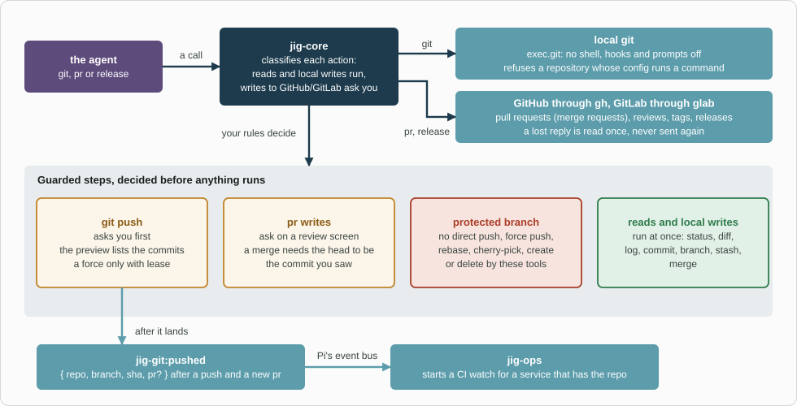

# jig-git: git, pull requests and releases

**Status: built.** Tested against temporary repositories and recorded GitHub
and GitLab answers, and in CI the reads are run against real GitHub. No test
writes to GitHub, and GitLab itself was never reached (see
[Not verified yet](docs/not-verified.md)).

`jig-git` gives the agent three tools: `git` for the local repository, `pr` for
pull requests and reviews, and `release` for tags and releases. `pr` and
`release` work on GitHub through `gh` and on GitLab, where a pull request is a
merge request, through `glab`. The host of `origin` decides which, never the
model ([GitLab](docs/gitlab.md)).

For example, "commit these two files, push, and open a pull request": `git
commit` takes exact paths, `git push` shows the commits it will send and waits
for you, and `pr create` shows the body on a review screen.

CI is not here: checks, runs, logs and CI watches are the `ci` tool of
[`jig-ops`](../jig-ops/README.md). The two meet in one event. After a push and
after a new pull request, `jig-git` announces `jig-git:pushed`, and `jig-ops`
starts a watch if it knows the repository (see [Events](#events)). The one
watch here is on the comments of a pull request: what people write on GitHub
reaches the agent without being asked for ([Comment watch](docs/comments-watch.md)).



*How a call runs. `jig-core` decides first: reads and local writes run, writes to GitHub or GitLab ask you. `git push`, the `pr` writes and a protected branch each have a guard, and after a push or a new pull request the plugin announces `jig-git:pushed` for `jig-ops`.*

## Tool: `git`

| Action | Kind | What it does |
|---|---|---|
| `status` | read | Branch, upstream, ahead and behind the base, changed files |
| `diff` | read | Working tree, staged, a range or the merge base, as a summary, names or a patch |
| `log` | read | A range or paths, filtered by author, date or message |
| `show` | read | A commit, or a file at a revision |
| `blame` | read | Who last changed each line |
| `branches` | read | Local and remote branches, their tracking, and which contain a commit |
| `fetch` | read | Branches and tags from the remote |
| `clone` | local write | `owner/name` into a new folder of the workspace, over SSH only |
| `branch` | local write | Create from the fetched base, switch, or delete a merged branch |
| `worktree` | read; adding and removing are local writes | List, add or remove worktrees |
| `commit` | local write | Exact paths and a message; amend only while no remote has the commit |
| `stash` | local write | Push, list, pop, drop |
| `sync` | local write | Fast-forward from the upstream |
| `merge` | local write | Merge the base or another branch; a conflict aborts cleanly |
| `rebase`, `cherry_pick` | local write | A conflict aborts cleanly; a protected branch is refused |
| `restore` | local write, asks | Discard changes in the listed paths; it destroys uncommitted work, so it asks |
| `push` | external write, asks | A branch, with the commits in the preview; never a force to a protected branch |

## Tool: `pr`

| Action | Kind | What it does |
|---|---|---|
| `view`, `list` | read | State, draft, mergeable, review decision, a roll-up of the checks, and body |
| `comments` | read | The conversation, reviews and line comments, with thread ids |
| `create` | external write, asks on the review screen | A pull request from a pushed branch; without a body, the template to fill in |
| `edit` | external write, asks on the review screen | Title, body, base, labels, reviewers |
| `ready` | external write, asks | Draft to ready |
| `comment`, `reply` | external write, asks on the review screen | A comment, or a reply in a review thread |
| `resolve` | external write, asks | Resolves a review thread |
| `review` | external write, asks on the review screen | Comment, or request changes. **Never approve:** approval stays human |
| `merge` | external write, asks | Merge, squash or rebase, only while the head is still the commit you saw |
| `watch` | local write | A background watch: new comments from people reach you in one message |

On GitLab the same actions work on merge requests, with a thread named `<number>:<id>`. What GitLab has no equivalent for is
refused in one line ([GitLab](docs/gitlab.md#what-gitlab-has-no-equivalent-for)).

## Tool: `release`

| Action | Kind | What it does |
|---|---|---|
| `tags`, `releases` | read | Tags (the latest matching a pattern, or those containing a commit); releases |
| `tag_create` | local write | An annotated tag, locally |
| `tag_push` | external write, asks | Push a tag |
| `release_create` | external write, asks | A GitHub or GitLab release |

The notes on single actions are in [Actions](docs/actions.md).

## Rules

- **Reads and local writes run; writes to GitHub or GitLab ask you.** Every tool declares
  the environment and effect of each action to `jig-core`, and a rule in your
  configuration can change any default, within the floor.
- **Which repository.** Every action takes an optional `repo`: a folder name in
  the workspace, or an absolute path inside a work tree. Without it, a call
  means the repository Pi started in. The workspace is the folder Pi started
  in, or, inside a repository, the folder that holds it.
- **The forge comes from the repository.** `github.com` is GitHub, `gitlab.com` is GitLab, and `git.forges` names a self-hosted
  host or an ssh alias for a real one. An origin on any other host is refused with the line that fixes it ([GitLab](docs/gitlab.md#which-forge-a-repository-is-on)).
  `gh` and `glab` own the sign-in; Jig never signs in.
- **Writes are previewed, and never repeated blindly.** A write that asks shows
  what it will do, and refuses if anything changed since. A lost reply is read
  once and never sent again (see [Writes](docs/writes.md)).
- **Comments reach the agent by themselves.** `pr create` starts a watch on the
  new pull request, and `pr watch` starts one on any open pull request. Comments
  are text from people: the message says they are information to weigh, not
  instructions to follow ([Comment watch](docs/comments-watch.md)).
- **`jig-git` never deploys,** and never starts a workflow. Deploys have their
  own tool and their own rules.

## Configure

In `~/.pi/agent/jig.json`, under `git`. All fields are optional; a company
plugin can set them for its repositories. `jig-core` reports an unknown or
invalid field, and the defaults apply instead.

| Field | Default | Meaning |
|---|---|---|
| `base` | the repository's default branch | The branch new work starts from and pull requests target |
| `protected` | the repository's default branch | Branches that refuse direct changes by these tools |
| `commitMessage`, `branchName`, `prTitle` | none | Regular expressions that commit messages, new branch names and pull request titles must match |
| `prTemplate` | the repository's own template | The path of a Markdown file with the pull request body template |
| `cloneHost` | `github.com` | The ssh host `clone` connects to: `github.com` or a `Host` alias |
| `watchComments` | `"after-create"` | `"after-create"`: `pr create` starts the comment watch. `"off"`: only `pr watch` does |
| `watchBots` | `false` | Whether the watch also tells the agent about comments by bots |
| `forges` | none | Hosts that are not github.com or gitlab.com: `{ "gitlab.example.com": "gitlab" }`; an ssh alias maps to its real host ([GitLab](docs/gitlab.md#an-ssh-alias-for-a-real-host)) |

The fields in detail are in [Configuration](docs/configuration.md).

```json
{
  "git": {
    "base": "main",
    "protected": ["main", "release/*"],
    "branchName": "^(feature|fix)/PROJ-\\d+",
    "commitMessage": "^PROJ-\\d+: ",
    "prTitle": "^PROJ-\\d+: "
  }
}
```

## Company part (in the company plugin)

- the `git` settings for its repositories: base and protected branches, branch,
  commit message and pull request title patterns, the pull request template, the
  clone host, and the self-hosted GitLab hosts (`forges`);
- later, the sign-in for a git host that is not `github.com` or `gitlab.com`.

## Events

`jig-git:pushed` is published on Pi's event bus after a push has landed and after
a pull request is created: `{ repo, branch, sha, pr? }`. `jig-ops` listens and
starts a CI watch for a service of its catalog that has the repository. A
listener that fails never undoes the push. The details are in
[Events](docs/events.md).

## Layout

```text
jig-git/
  src/      git.ts, pr.ts and release.ts (the three tools); the actions (git-read, git-branch + git-changes +
            git-integrate with git-guards for the local writes, git-remote, clone, pr-read, pr-write); the comment watch (pr-watch, pr-watch-tool); github.ts, gitlab.ts and the GitLab
            actions (gitlab-pr-read, gitlab-pr-write, gitlab-release, gitlab-watch); forge.ts and repo.ts; config.ts,
            previews.ts and events.ts (jig-git:pushed)
  skills/   git/SKILL.md: how to use the tools (status before commit, what a push announces)
  test/     against temporary local repositories, a fake gh and glab and a fake jig-core
  docs/     the detail pages below
```

## More detail

- [Events](docs/events.md): `jig-git:pushed`, who publishes it, and what a listener can rely on
- [GitLab](docs/gitlab.md): the forge for a repository, how each action maps to glab, what GitLab has no equivalent for
- [Comment watch](docs/comments-watch.md): `pr watch`, what the agent is told, what is skipped, rate limits, when it ends
- [Actions](docs/actions.md): notes on single actions of `git` and `pr`
- [Configuration](docs/configuration.md): the fields of the `git` section in detail
- [Writes](docs/writes.md): what you see before a write asks, and lost replies
- [Scope](docs/scope.md): what is left out on purpose, and what belongs elsewhere
- [Background](docs/background.md): the sessions the tool list comes from, and what was ported
- [Not verified yet](docs/not-verified.md): what the tests do not cover
