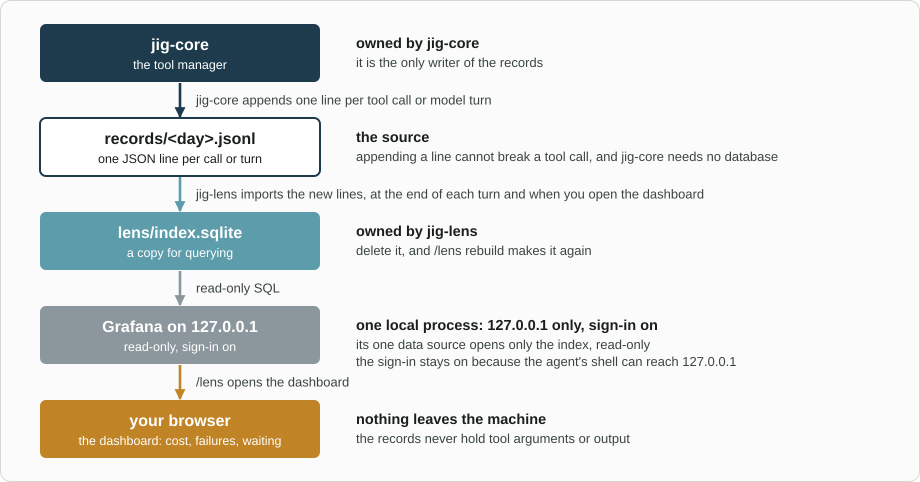

# jig-lens: what happened, and what it cost

**Status: built.** The summary is tested with sample records, a fake Pi and a real
Pi session on a scripted model, and was seen in Pi 1.4.0's terminal on Linux; the
RPC notification is tested with a fake screen only.

`/lens usage` is tested with session files and a fake screen, and was seen in the
same terminal. The dashboards were tried with Grafana 13.3 and its SQLite data
source 4.0.6 on Linux. macOS is not tried yet.

`jig-lens` shows what `jig-core` [records](../jig-core/docs/records.md): cost, tool
failures, and time spent waiting for you. `/lens` prints a summary inside Pi, with
no server and no install. Grafana, or Datasette, is an optional deep dive. It
never changes the records, and nothing leaves the machine.

`/lens usage` is a quick view of cost and tokens from Pi's own session files;
TokenTelemetry goes further (see [Reuse](../../docs/reuse.md)). `jig-lens` adds what only
Jig's records hold: rule decisions, approvals and time waited, tickets and checks. For
example, `/lens ticket PROJ-123` after a morning's work:

```text
Ticket PROJ-123, all time
  Cost       $1.41 over 6 turns, 309k tokens in (92% read from cache), 6.0k out
             by model  claude-sonnet-5-5  $1.10
                       claude-opus-5      $0.31
  Tools      34 calls, 2 failed, 2 blocked
             failing  bash            2 of 8  tool 2
             slowest  ci watch    p95 4m 10s  1 call
                      bash           p95 12s  8 calls
                      git push      p95 2.4s  2 calls
                      git status    p95 80ms  3 calls
                      read          p95 36ms  12 calls
  Your time  2 questions: 1 allowed, 1 allowed for the session
             waited 53s in total, median 27s
             by tool  git push  53s  2 questions
  Blocked    2 calls
             rule  denied  2  http 2
  Checks     ci watch  conclusion success, failed 0, passed 412  2h ago
```



*How the records reach the screen: `jig-core` appends them, `jig-lens` keeps a copy it can rebuild, the `/lens` summary reads that copy inside Pi, and Grafana, if you start it, reads it read-only on `127.0.0.1`, with its sign-in on.*

## Commands

| Command | What it does |
|---|---|
| `/lens` | Imports new lines, then shows today, this session, and the session's ticket |
| `/lens ticket KEY` | One ticket, over all time |
| `/lens session [id]` | One session. Without an id, this one |
| `/lens days N` | The last N days, from 1 to 90, the last of them today |
| `/lens usage` | An interactive view of cost and tokens from Pi's own session files |
| `/lens grafana` | Imports, starts Grafana if it is not running, and opens its dashboards |
| `/lens datasette` | The same for Datasette |
| `/lens rebuild` | Deletes the index and imports every record file again. The viewers are not touched |
| `/lens status` | The viewer on the port, the index size, the last import, and the lines skipped |

Anything else, or the wrong arguments (`/lens days 91`), shows the usage line and
does nothing: `Usage: /lens [ticket KEY | session [id] | days N | usage | grafana | datasette | rebuild | status]`.

## Rules

- **Read-only over the records.** They belong to `jig-core`. The index is a copy
  that `/lens rebuild` makes again.
- **Separate from `jig-core`,** so the guard works without the summary.
- **The summary is for you, not the model.** In a terminal it is a session entry
  that the model never receives; over RPC, a shortened notification; with no
  screen, nothing.
- **Today is your day,** from midnight on your clock, not a UTC day.
- **Text here, charts elsewhere.** An existing viewer draws them, on `127.0.0.1`
  only, and Grafana's sign-in stays on.

## Configure

In `~/.pi/agent/jig.json`, under `lens`. The field is optional. `jig-core` checks
the section when a session starts; a mistake names the key, and the defaults apply.

| Field | Default | Meaning |
|---|---|---|
| `port` | 3300 | The port of Grafana or Datasette on `127.0.0.1` |

```json
{ "lens": { "port": 3300 } }
```

`viewer` is gone: the command names the viewer now (see
[Viewer settings](docs/viewer-settings.md#the-viewer-setting-is-gone)).

## Later

- **OpenTelemetry export to MLflow,** for trace waterfalls, and **Datasette
  charts** through `datasette-dashboards`.
- **The harness watching itself,** from the records and closed tickets.
- **Not shown yet:** cost while waiting for you, retries and repeated failures,
  and one ticket's calls in order (see [The summary](docs/summary.md#not-shown-yet)).

## Layout

```text
jig-lens/
  src/      the import and /lens (lens, command, scopes), the figures (queries, summary, format, period),
            the viewers (start, viewer), the index (store, import, parse), and usage-*.ts for /lens usage
  viewer/   Grafana provisioning and dashboards, as files; Datasette's metadata and queries
  test/     sample records, a fake Pi and a real Pi session, 100 000 calls timed, every dashboard query
  docs/     the detail pages below
```

## More detail

- [The summary](docs/summary.md): scopes, sections, how it is shown, the commands
- [The usage view](docs/usage.md): `/lens usage`, its keys, what it reads, naming the models
- [From the records to the index](docs/import.md): imports, retention, one viewer process
- [The index](docs/index-schema.md): tables, SQL indexes, how fast
- [Grafana and Datasette](docs/viewers.md): the dashboards, why these viewers, what to install
- [Viewer settings](docs/viewer-settings.md): how they run, and why the sign-in stays on
- [Starting Grafana](docs/starting-grafana.md): what `/lens grafana` does, step by step
- [Later](docs/later.md): the export to MLflow, Datasette charts, the harness watching itself
