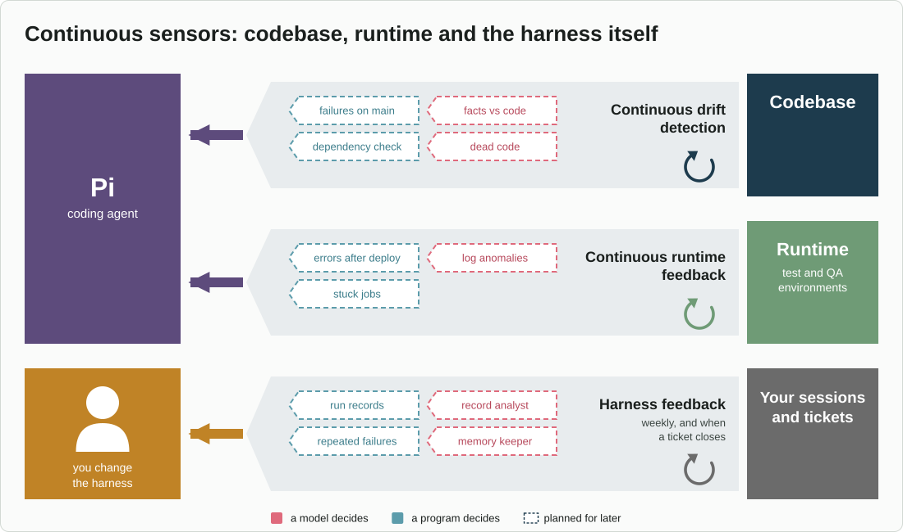

# jig-lens: what happened, and what it cost

**Status: built.** The import, the commands, five Grafana dashboards and the
Datasette fallback work. They were tried with Grafana 13.3 and its SQLite data
source 4.0.6 on Linux; macOS is not tried yet. This README is the specification
the code follows.

`jig-lens` shows `jig-core`'s records in a local dashboard: cost, tool
failures, and time spent waiting for you. It never changes the records, and
nothing leaves the machine.

For cost, tokens and sessions, use TokenTelemetry, which reads Pi's own
session logs (see [Reuse](../../docs/reuse.md)). `jig-lens` adds what only
Jig's records hold:
- rule decisions;
- approvals and time waited;
- tickets;
- checks.

## What it shows

Five dashboards, in a Grafana folder named Jig. A day is a UTC day, as in the
record files.

| Dashboard | Questions it answers |
|---|---|
| Overview | Cost per day, per model, per agent role (the main agent, or a child such as a reviewer or a scout), per ticket and per session; cache hit rate; calls and errors per day |
| Tools | Calls and failures per tool and per error kind; the slowest tools; calls refused by a rule; recent failures |
| Your time | Questions asked per tool and per ticket, and how long calls waited for you |
| Checks | Calls that carry facts: test counts and CI conclusions, and every fact name in use |
| Session | Every call and turn of one session in order, with decisions and results |

Tables link one level down: click a session in a table, and the Session
dashboard opens with that session chosen. To see one day's sessions, select the
day in the time picker; the Overview's session table then lists that day's.

**Not shown yet:**
- cost while waiting for you, because a turn record has no duration;
- retries and repeated failures;
- runs blocked by failures that already exist on the main branch, which no
  tool reports yet;
- one ticket's calls and turns in order; the Session dashboard takes a session.

## How it works


*How the records reach the dashboard: `jig-core` appends them, `jig-lens` keeps a copy it can rebuild, and Grafana reads that copy read-only on `127.0.0.1`, with its sign-in on.*

<details>
<summary>Text version</summary>

```text
 jig-core ── appends ──▶ records/<day>.jsonl     owned by jig-core: the source
                               │
                               │ jig-lens imports new lines
                               ▼
                         lens/index.sqlite        owned by jig-lens: a copy it can rebuild
                               │
                               │ read-only SQL
                               ▼
                         Grafana on 127.0.0.1     dashboards kept as files in this plugin
                               │
                               ▼
                         your browser
```

</details>

- **The record files stay the source.** Appending a line is the cheapest write
  that cannot break a tool call, and it keeps `jig-core` free of a database.
  `jig-lens` only opens them for reading.
- **The index is a copy for querying.** Delete it and `/lens rebuild` makes it
  again, so its tables can change without migrations.
- **Imports are incremental and safe to repeat.** `jig-lens` remembers how far
  it has read each file and inserts by record id, so two sessions importing at
  once, or a rebuild, cannot count anything twice. Only complete lines are
  imported; a line still being written waits for the next import. A file is one
  transaction, and it moves the file's offset too.
- **A line that is not a record is skipped,** counted, and shown by `/lens
  status`. It never stops the import. A record file that cannot be read is
  reported and the others are still imported.
- **Imports run** at the end of each agent run in any session that loads
  `jig-lens`, and when you open the dashboard. One that fails is said once, in
  the session.
- **Rows older than the records' retention** are removed at import. The index
  keeps 90 days, the default of `records.retentionDays`, by the rule `jig-core`
  deletes files by: a day's rows go when the day is more than 90 days before
  today. A plugin cannot read `jig-core`'s setting, so a value changed there does
  not change this one.
- **The viewer is one process for every session.** It is started detached, so
  it keeps running when Pi exits and another session finds it already there.
  Jig does not stop it; `/lens` prints its process number when it starts it.

## Index

`~/.local/state/jig/lens/index.sqlite`, private to you (mode 0600, in a folder
with mode 0700), in WAL mode so that Grafana can read while a session writes.
Two sessions that write at once wait for each other for up to five seconds.

Times are seconds since the epoch, because Grafana's SQLite data source reads
numbers as seconds.

| Table | One row per | Columns |
|---|---|---|
| `call` | tool call | the tool-call record's fields under their own names (see [`jig-core`](../jig-core/README.md#records)), with `facts` as JSON text |
| `turn` | model turn | the model-turn record's fields under their own names |
| `imported` | record file | `file`, `bytes` (how far it has been read), `skipped` (lines that are not records) and `at` (when it was last imported) |

Read the facts with `json_extract(facts, '$.passed')`. A field that does not
apply is `NULL`. The tables are plain, not `STRICT`, so that Datasette can read
the file with whatever SQLite its Python was built with.

Grafana keeps its own data, such as your sign-in, in
`~/.local/state/jig/lens/grafana/`, and what it and Datasette print in
`~/.local/state/jig/lens/viewer.log`, which each start empties.

## Viewer

**The everyday view is `/lens` inside Pi:** a summary with no server and no
install. Grafana is an optional deep dive (`/lens grafana`) for when charts
and drill-down are wanted.

Chosen on 2026-10-30 from a comparison of LLM trace platforms, OpenTelemetry
backends, SQL dashboards and tools built for coding agents. Each was judged on
local-only operation, setup, charts, licence, and Linux and macOS support.

| Viewer | Verdict | Why |
|---|---|---|
| Grafana OSS with the SQLite data source plugin | **optional deep dive** | One local process and no containers. SQL panels, a variable for the session and the ticket, and links from a summary to its detail. The data source and dashboards load from files kept in this plugin |
| Datasette | fallback | One Python process over the same index. The queries kept in this plugin show as tables; charts with `datasette-dashboards` come later |
| MLflow, through OpenTelemetry export | later | Trace waterfalls and LLM views, if they are wanted. An export from the index, not a second record |
| Arize Phoenix | skip | A richer trace view, but its licence (Elastic-2.0) is not an open-source one, and its dashboards are fixed |
| Langfuse, Opik, SigNoz, OpenLIT | skip | Three to seven containers each, with ClickHouse or Postgres: too heavy for one developer |

**Risk.** The SQLite data source is a small community plugin, last released in
May 2026. It was tried with Grafana 13.3 and plugin 4.0.6 on Linux: the index
opens read-only in WAL mode and every dashboard query runs. macOS is not tried
yet. If the plugin fails, Datasette takes its place over the same index, with
no change to the import.

## Settings

Grafana runs with:
- `127.0.0.1` only, on the port from configuration;
- usage reports, update checks, plugin update checks and feedback links
  switched off (Grafana's `[analytics]` settings). The news feed, the avatar
  lookup and the download of preinstalled apps are off too, because a default
  Grafana 13 fetches them from the internet;
- its sign-in on and anonymous access off. On first start you sign in as
  `admin`, whose initial password is `admin`, and Grafana asks you to set a new
  one; do not skip that step. Until you do, any program on the machine can sign
  in. Jig never sets or stores it, and `/lens` says so the first time;
- one data source, which opens only the index, read-only (`mode=ro`);
- dashboards that the browser cannot save over. Save a copy under another name
  to keep a change;
- a short environment: `PATH`, `HOME` and the like, not Pi's. An API key, or a
  `GF_` setting such as an admin password, in the shell does not reach it.

Installing the plugin contacts grafana.com once. After that, nothing leaves
the machine.

Datasette, as the fallback, runs with arbitrary SQL turned off
(`allow_sql: false`), so the page runs only the queries kept in this plugin and
its own table pages.

**Why the sign-in stays on.** The agent's shell can reach `127.0.0.1`; that is
also why approvals never happen in the browser. Anyone who can query a Grafana
data source can send it any SQL, and SQLite's `ATTACH` opens other database
files that Grafana can read. Open access would let the agent read, through
Grafana, files that the sandbox hides from it.

## Commands

| Command | What it does |
|---|---|
| `/lens` | Imports new lines, starts the viewer if it is not running, and opens the dashboard |
| `/lens rebuild` | Deletes the index and imports every record file again. The viewer is not touched |
| `/lens status` | The viewer's address and state, the index size and counts, the time of the last import, and the lines that were skipped |

**`/lens` in detail:**
- **It asks first** whether something answers on the port. If something does that
  is not the viewer, it says so and stops.
- **It finds `grafana`, else `grafana-server`, on `PATH`** (only in absolute
  folders), and starts it detached. When Grafana's home folder is beside the
  program, or in `share/grafana`, it passes `--homepath`; a packaged install's
  wrapper does that itself.
- **It waits up to a minute** for Grafana to answer, which the first start can
  need on a busy machine, and says when the program stops at once or never
  answers. What it printed is in `viewer.log`.
- **It opens `/d/jig-overview`** (Datasette: its page for the index) through
  `$BROWSER`, else `xdg-open`, else `open` on macOS, and otherwise gives the
  address.
- **Without Grafana** it says how to install it and the plugin
  (`grafana cli plugins install frser-sqlite-datasource`), and mentions Datasette.

## Configure

In `~/.pi/agent/jig.json`, under `lens`. All fields are optional. `jig-core`
checks the section when a session starts; a mistake names the key, and the
defaults apply.

| Field | Default | Meaning |
|---|---|---|
| `viewer` | `grafana` | `grafana` or `datasette` |
| `port` | 3300 | The viewer's port on `127.0.0.1` |

## Rules

- **Read-only over the records.** They belong to `jig-core`.
- **Separate from `jig-core`,** so the guard works without the dashboard.
- **No charts of our own.** An existing viewer draws them.

## Prerequisites

- `jig-core`, whose records this reads.
- Node 22.13 or later, for `node:sqlite`.
- Grafana OSS and its `frser-sqlite-datasource` plugin, installed by you: a
  package manager on Linux, Homebrew on macOS. Jig does not bundle them.
  `grafana cli plugins install frser-sqlite-datasource` needs the folder
  Grafana loads plugins from: usually `sudo` for a package install, or
  `--pluginsDir <home>/data/plugins` for an unpacked download. Restart Grafana
  after it.
- For the fallback: Datasette, through `pip`.

## Later

- **OpenTelemetry export to MLflow,** for trace waterfalls. Each call becomes
  an `execute_tool` span and each turn a `chat` span, grouped by session.
- **Datasette charts,** through `datasette-dashboards`.

## Later: the harness watching itself



*Sensors that run outside any one change, in [Böckeler's](https://martinfowler.com/articles/harness-engineering.html) layout, with a third row of our own: the harness watching itself. Codebase and runtime sensors feed the coding agent; harness sensors, built from the records and closed tickets, feed you, because changes to the harness are yours to approve.*

## Layout

```text
jig-lens/
  src/          index.ts (the entry), lens.ts (the import at the end of a run, and /lens),
                start.ts and viewer.ts (starting Grafana or Datasette), import.ts, parse.ts and
                fields.ts (records to rows), store.ts (the index file), config.ts, paths.ts,
                programs.ts, report.ts, deps.ts
  viewer/
    grafana/    provisioning for the data source and dashboards, one JSON file per dashboard
                (its plugins/ and alerting/ folders are empty on purpose: Grafana logs an error
                for a provisioning folder that is missing)
    datasette/  metadata and canned queries for the fallback
  test/         import against sample record files; commands with a fake Pi; every dashboard
                query run on a real index
```
