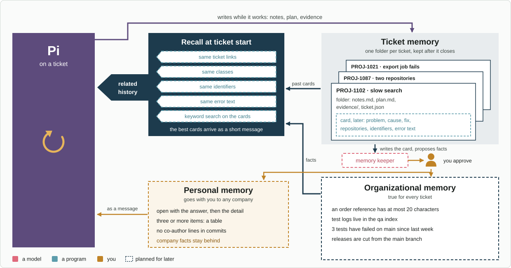
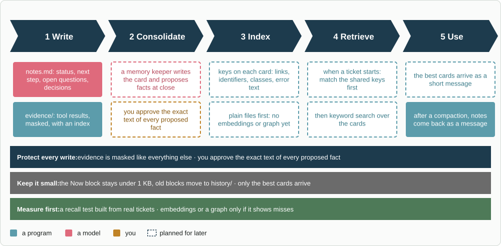

# jig-memory: ticket folders, notes and recall

**Status: ticket folders built.** Tested against a fake `jig-core` and a fake Pi,
not yet in a real Pi session. Cards and recall are design (see
[Later](#later)).

`jig-memory` keeps what the agent learns about a ticket in files that outlive
the session. Later it finds earlier tickets related to a new one. For example,
naming `PROJ-123` in a message creates that ticket's folder with a notes file,
and after a compaction the notes come back to the agent as a message.



*Three kinds of memory and the paths between them. Pi writes ticket memory as it works; later, a memory keeper writes a card at close and proposes organizational and personal facts, kept only with your yes, and recall hands Pi related cards when a new ticket starts.*

## The ticket folder

Each ticket has a folder outside every repository:

| File | What it holds |
|---|---|
| `notes.md` | A `## Now` block (status, next step, open questions) kept under 1 KB, then decisions. Old blocks move to `history/` |
| `plan.md` | The plan `jig-workflow` asks you to approve |
| `evidence/` | Tool results captured while the ticket is active, masked like everything else, with an index |
| `ticket.json` | The repositories bound to the ticket |

This scope has no model-callable tools. The agent uses Pi's file tools, and this
plugin captures evidence through `jig-core`'s events.

## Commands

| Command | What it does |
|---|---|
| `/ticket KEY` | Makes the ticket active at once, and switches from another |
| `/ticket` | Shows the active ticket |
| `/ticket off` | Clears the active ticket |

## Rules

- **Active ticket.** Naming a ticket in a message makes it active for the
  session, and `/ticket KEY` sets it explicitly. When another ticket is already
  active, the message only gets a hint (see [Activation](docs/behaviour.md#activation)).
- **Notes as a message.** After a compaction, the notes come back as a message,
  never in the system prompt, so the prompt cache stays valid.
- **Reminders.** The agent is reminded to update `## Now` when many results
  arrive without a notes change.

## Configure

In `~/.pi/agent/jig.json`, under `memory`. `jig-core` checks it with this
plugin's rules. An error names the key, and the plugin then uses its defaults.

| Field | Default | Meaning |
|---|---|---|
| `ticketPattern` | none | A regular expression for ticket keys, such as `[A-Z][A-Z0-9]+-\d+`. A key must not touch a letter or digit on either side. Without it, only `/ticket KEY` activates a ticket |
| `folder` | `~/.local/share/jig/tickets`, or under `XDG_DATA_HOME` | Where ticket folders live: an absolute path, or one that starts with `~/`. An empty or relative `XDG_DATA_HOME` is ignored |

```json
{
  "memory": {
    "ticketPattern": "[A-Z][A-Z0-9]+-\\d+",
    "folder": "~/work/tickets"
  }
}
```

## Company part (in the company plugin)

- the ticket key patterns;
- where ticket folders live.

## Later

- **A card per closed ticket:** problem, cause, fix, repositories, identifiers
  and error text.
- **Recall:** when a new ticket starts, related tickets are found by shared
  keys (links, identifiers, classes, error text), then by keyword search, and
  their cards arrive as a short message.
- **A memory keeper** that proposes organizational and personal facts at ticket
  close. You approve the exact text of every one.
- **Files and keyword search first.** Embeddings or a graph come only after a
  recall test built from real tickets shows misses.



*Memory in five steps, from notes while the agent works to a short message at the start of a later ticket. Lookup is keys and keyword search over plain files; embeddings or a graph wait for a measured miss.*

## Layout

```text
jig-memory/
  src/      index.ts (the factory), session.ts (the active ticket, its events and /ticket),
            store.ts (the ticket folder), notes.ts (the ## Now rule), evidence.ts,
            message.ts (the notes message and the reminder), clip.ts, config.ts
  test/     one file per module, and support.ts (a fake jig-core and a fake Pi)
  docs/     the detail page below
```

## More detail

- [How it behaves](docs/behaviour.md): folders, activation, the notes message,
  the `## Now` block, reminders, evidence, and a known gap
