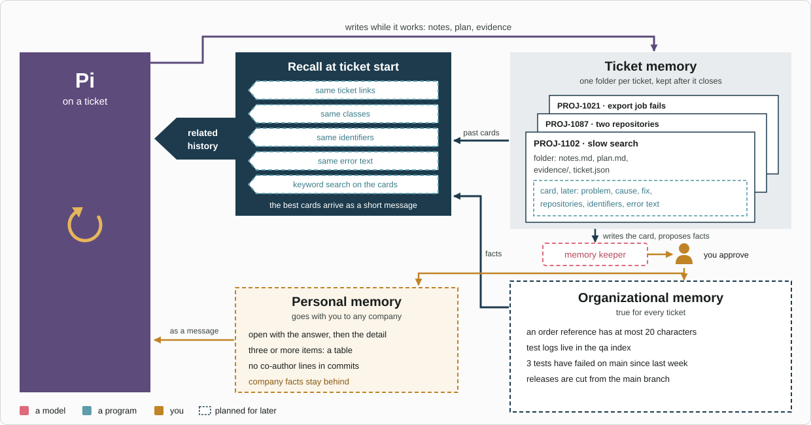

# jig-memory: ticket folders, notes and recall

**Status: ticket folders, cards, derived notes entries and recall built.** Tested
against a fake `jig-core`, a fake Pi, and a stock Pi 1.5.0 loaded from this
checkout through `pi install` (invented tickets only). The memory keeper is design (see [Later](docs/later.md)). The derived notes
entries are off by default: the real-ticket test found too much noise and little
recall (see [Recall](docs/recall.md#measured-on-our-own-tickets)).

`jig-memory` keeps what the agent learns about a [ticket](../../docs/glossary.md#tickets-and-workflows)
in files that outlive the session, sums a closed ticket up in a short
[card](../../docs/glossary.md#tickets-and-workflows), and hands the agent related
earlier tickets when a new ticket starts: their cards, or entries derived from
their notes when no card exists.

For example, naming `PROJ-123` in a message creates that ticket's folder with a
notes file, and after a compaction the notes come back to the agent as a
message. `/ticket close` leaves a card, and a later ticket that hits the same
error starts with that card in front of the agent.



*Three kinds of memory and the paths between them. Pi writes ticket memory as it works, and a card at close; recall hands Pi related cards, or entries derived from notes, when a new ticket starts. The organizational and personal memory, and the memory keeper that proposes it, are still design.*

## The ticket folder

Each ticket has a folder outside every repository:

| File | What it holds |
|---|---|
| `notes.md` | A `## Now` block kept under 1 KB (status, next step, open questions), then decisions |
| `plan.md` | The plan `jig-workflow` asks you to approve |
| `evidence/` | Tool results captured while the ticket is active, masked like everything else, with an index |
| `ticket.json` | The repositories bound to the ticket |
| `workflow.json` | The state of the ticket's workflow, written only by `jig-workflow` |
| `checks.json` | The open checks, and the closed ones with their outcome ([Handoff](docs/handoff.md#the-checks-file)) |
| `card.md` | The card, written at close (see [Cards](docs/cards.md)) |

The folder of all tickets also holds `.cards.json`, an index of the cards that
recall reads and rebuilds by itself. The agent writes notes with Pi's file tools,
and this plugin captures evidence through `jig-core`'s events. Every file it
writes is synced to disk before it takes its name, so a killed machine never
leaves one empty.

## Tool: `ticket`

The handoff record of the active ticket: what the user ran and pasted, what the
agent said it would do before the next step, and a read-only search of earlier
tickets ([Handoff](docs/handoff.md)).

| Action | Kind | What it does |
|---|---|---|
| `save_evidence` | local write | Saves text the user pasted, such as a run's output, to `evidence/`, masked |
| `add_check` | local write | Adds an open check: something to do before the next step |
| `list_checks` | read | The open checks, and how many are closed |
| `close_check` | local write | Closes a check by its number, with what was found or done |
| `recall` | local read | Searches earlier tickets' cards and notes by an error, class name or behaviour; the active ticket is left out |

## Commands

| Command | What it does |
|---|---|
| `/ticket KEY` | Makes the ticket active at once, and switches from another |
| `/ticket` | Shows the active ticket |
| `/ticket off` | Clears the active ticket |
| `/ticket close [KEY]` | Drafts the card, asks the agent to fill it, checks it, and closes the ticket |
| `/ticket recall [text]` | Shows the earlier tickets related to the active ticket, or to the text |

## Rules

- **Active ticket.** Naming a ticket in a message makes it active for the
  session, and `/ticket KEY` sets it explicitly. When another ticket is already
  active, the message only gets a hint (see [Activation](docs/behaviour.md#activation)).
- **Notes as a message.** After a compaction, the notes come back as a message,
  never in the system prompt, so the prompt cache stays valid.
- **Reminders.** The agent is reminded to update `## Now` when many results
  arrive without a change to `## Now` itself, and is told today's date.
- **Open checks** are shown with every prompt until closed. Before the agent
  hands you a command for the next step, it closes or names each one.
- **Empty files.** When a ticket becomes active or is restored, files in its
  folder that are empty and changed in the last 7 days are named to the agent
  and to you. Nothing is repaired.
- **Cards.** The plugin fills the front matter from the notes and evidence; the
  agent writes Problem, Cause and Fix, each up to 400 characters, and the plugin
  rejects a card that lacks one or has one too long (see [Cards](docs/cards.md)).
- **Recall.** When a new ticket becomes active, other tickets' cards are scored by
  shared keys, identifiers and error lines, then by keyword search, and the best
  few arrive as one message. If `memory.recall.notes` is on, entries derived from
  earlier notes are searched too, labelled with their date and that they may be out
  of date. Automatic recall takes only a shared name, ID or error; `/ticket recall`
  also takes a rare word. Each automatic message is recorded for `jig-lens` with
  its entry count and no text. Nothing arrives when nothing scores enough.

## Configure

In `~/.pi/agent/jig.json`, under `memory`. `jig-core` checks it with this
plugin's rules. An error names the key, and the plugin then uses its defaults.

| Field | Default | Meaning |
|---|---|---|
| `ticketPattern` | none | A regular expression for ticket keys, such as `[A-Z][A-Z0-9]+-\d+` |
| `folder` | `~/.local/share/jig/tickets` | Where ticket folders live: an absolute path, or one that starts with `~/` |
| `recall.enabled` | `true` | Recall at all: automatic messages, `/ticket recall` and `ticket recall`; false stops all three |
| `recall.max` | `3` | Most cards in one recall message, from 1 to 10 |
| `recall.minScore` | `2` | The score an entry needs; see [Recall](docs/recall.md#the-threshold-and-the-budget) |
| `recall.notes` | `false` | Search entries derived from notes in **automatic** recall; off because it missed the half-noise bar (0.818 to 0.455). `/ticket recall` and `ticket recall` always search notes |
| `recall.maxNotes` | `1` | Most derived notes entries in one manual result, from 0 to `max`; automatic recall is always capped at one whatever this says |

Field notes and an example: [Configure](docs/configure.md).

## Company part (in the company plugin)

- the ticket key patterns;
- where ticket folders live.

## Layout

```text
jig-memory/
  index.ts  the entry Pi loads: it hands on src/index.ts, so Pi shows the plugin's name
  src/      index.ts (the factory), session.ts (the active ticket, its events and /ticket),
            store.ts (the ticket folder), notes.ts (the ## Now rule), evidence.ts,
            tool.ts (the ticket tool), checks.ts (checks.json), empty-files.ts,
            message.ts (the notes message and the reminder), clip.ts, config.ts,
            extract.ts (keys, identifiers, error lines), card.ts (the card file),
            material.ts (what a ticket holds), cards.ts (the .cards.json index),
            bm25.ts (keyword search), notes-index.ts (derived entries), recall.ts (scoring and its message), close.ts
  skills/   ticket-memory/SKILL.md: dating notes, keeping ## Now current, pasted evidence, open checks
  scripts/  recall-eval.mjs (recall on a tickets folder, aggregates only)
  test/     one file per module, support.ts (a fake jig-core and a fake Pi), and
            recall-eval/ (invented cards and queries, and the recall measure)
  docs/     the detail pages below
```

## More detail

- [Configure](docs/configure.md): each field of the `memory` section, with an example
- [Later](docs/later.md): what is not built yet, and why
- [How it behaves](docs/behaviour.md): folders, activation, the notes message,
  the `## Now` block, reminders, evidence, empty files, and a known gap
- [Handoff](docs/handoff.md): the `ticket` tool, pasted evidence, open checks and
  the `checks.json` file other programs read
- [Cards](docs/cards.md): the file, what the plugin fills, what the agent writes,
  how a close runs and what is rejected
- [Recall](docs/recall.md): when it runs, the score, the threshold, the message,
  the index and the recall test
