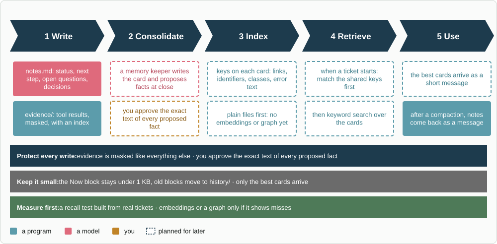

# jig-memory: later

What is not built yet, and why.

- **A memory keeper** that proposes organizational and personal facts at ticket
  close. You approve the exact text of every one.
- **Ticket text from `jig-jira`.** Recall uses the activating message only,
  because `jig-jira` does not publish an issue's summary and description on
  Pi's event bus. If it ever does, recall can use them too.
- **Files and keyword search first.** Embeddings or a graph come only after a
  recall test built from real tickets shows misses. `scripts/recall-eval.mjs` now
  measures a real folder, but the current one has only four explicit links: too few
  to decide, and enough to show the notes index is noisy (see [Recall](recall.md#measured-on-our-own-tickets)).
  A close that writes cards automatically is also not built; only a person's
  `/ticket close` writes one.

*Memory in five steps, from notes while the agent works to a short message at the start of a later ticket. Lookup is keys and keyword search over plain files; embeddings or a graph wait for a measured miss. In this plugin the agent writes the card, not a memory keeper.*
