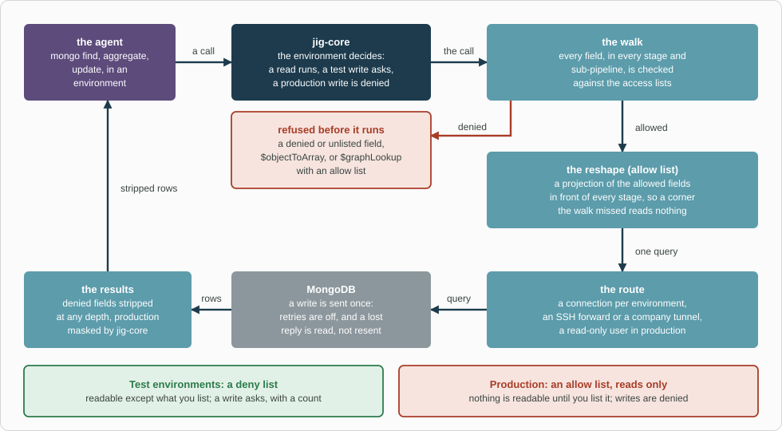

# jig-mongo: MongoDB, with reads, writes, indexes and aggregation

**Status: built.** Every action below is tested against fakes, and in CI against a real MongoDB 8.0 replica set, reached directly, through an
SSH forward and through a SOCKS tunnel (`ssh -D`) to a real SSH server. What is still unproved is in
[Not verified yet](docs/not-verified.md).

`jig-mongo` gives the agent a complete MongoDB tool: exploring, querying, indexes, query plans, aggregation and writes.
`jig-core` decides each call by environment: reads run, a write to `staging` asks you with a preview, and every write to
production is denied. What the agent may see is set by an allow list or a deny list.

For example, to debug a stuck order the agent runs `count`, then `find` on `orders.orders` in `staging`. It then runs `explain`
to see whether the query used an index, and `update` to fix the test document, after you approve the preview.



*How a call is checked and run. `jig-core` decides by environment, then the walk checks every field against the lists and refuses a denied one before anything runs. An allow list also reshapes the call, the route reaches MongoDB, and denied fields are stripped from the rows.*

## Tool: `mongo`

| Group | Action | Kind | What it does |
|---|---|---|---|
| Explore | `databases`, `collections` | read | What exists, minus everything denied |
| | `schema` | read | Field names and types, from a sample |
| | `stats` | read | Sizes and counts of a collection or database |
| Indexes | `indexes` | read | The indexes of a collection |
| | `index-stats` | read | How often each index is used (`$indexStats`) |
| | `explain` | read | The plan of a query: which index, documents examined, time |
| Query | `count`, `find`, `distinct`, `sample` | read | Documents, with filter, projection, sort and limit |
| Aggregation | `aggregate` | read, or write | The full pipeline. With `$out` or `$merge` it is a write |
| Write | `insert`, `update`, `replace`, `delete`, `bulk` | write | Changes documents. `update` and `delete` take `one` or `many` |
| Index changes | `create-index`, `drop-index` | write | Changes indexes |

Filters, documents and pipelines are Extended JSON, such as `{"$oid": "..."}`, and so are the results, so an `_id` from one
call can be used in the next. A result that reaches its limit (1 to 2000, default 20) is marked "possibly partial".
Parameters and results: [Results](docs/results.md).

## Access: an allow list or a deny list

| | Test environments | Production |
|---|---|---|
| Default | **Deny list:** everything is readable except what you list | **Allow list:** nothing is readable until you list it |
| Why | Test data is there to be explored | A new sensitive collection is never shown by accident |

- **Always denied, in every environment:** the databases `admin`, `local` and `config`, `system.*` collections, and fields whose
  names look like credentials (`*password*`, `*secret*`, `*token*`, `*apiKey*`, in any case). You can add to these, never remove them.
- **Lists reach fields, not only collections.**
  - `find` and `sample` strip denied fields from every result, at any depth. In production they return only allowed fields, as a
    forced projection.
  - `aggregate` is refused before it runs when it names a denied field anywhere: a rename such as `{ x: "$password" }`,
    `$getField`, a `$lookup`, `$graphLookup` or `$unionWith` into a denied collection, `$replaceRoot`, a `$facet` branch.
  - With an allow list a projection of the allowed fields is also put in front of every stage ([Access](docs/access.md)).
- **A denied collection cannot be written either.**

## Rules

- **Writes are previewed with a count.** The preview shows the filter, the change, and how many documents it touches, counted just
  before. If that count changes before the write runs, it is refused as "changed since the preview".
- **Guards on writes:** an `update` or `delete` with an empty filter is refused; `many` above 1000 documents needs a `limit` you
  raise on purpose ([Writes](docs/writes.md)).
- **Server-side JavaScript is refused** (`$where`, `$function`, `$accumulator`), unless you allow it for a test environment.
- **A lost reply is never resent.** One read checks what happened.
- **Production is read-only and masked,** whatever the configuration says: writes and index changes are refused when the call is
  classified, and `jig-core` masks every production result.

## Configure

In `~/.pi/agent/jig.json`, under `mongo`. An unknown field is an error, and the tool then does nothing until the file is fixed
(`/jig` lists the problems).

```json
{
  "mongo": {
    "connections": {
      "staging":    { "uri": "mongodb://db.staging.example.com:27017", "user": "agent", "password": "pass:mongo/staging" },
      "production": { "uri": "mongodb://db.example.com:27017", "user": "agent-readonly", "password": "pass:mongo/production",
                      "via": { "ssh": { "host": "bastion.example.com", "user": "agent", "key": "pass:ssh/bastion" } } }
    },
    "access": {
      "staging":    { "deny":  ["billing.cards", "*.notes"] },
      "production": { "allow": { "orders.orders": ["_id", "status", "items", "createdAt"] } }
    }
  }
}
```

| Field | Meaning |
|---|---|
| `connections` | Per environment: one connection, or named ones, each with `uri`, `user`, `password` and more |
| `via` | An SSH forward, or a company tunnel, as a forward or a SOCKS proxy ([Connections](docs/connections.md)) |
| `access` | Per environment, or per connection where there are several: `deny` or `allow` |

- **`uri`** holds no credentials: one that has them is refused. **`password`** is a secret reference. **`user`** is a name, or a
  secret reference such as `pass:mongo/staging-user`.
- **`via`** is `{ "ssh": { host, user, key, port? } }`, with `key` a secret reference, or `{ "tunnel": "<name>" }`.
  - A SOCKS tunnel reaches every member of a replica set or `mongodb+srv` address.
  - An SSH forward or a forward tunnel reaches one host.
- **Several connections in one environment** (`orders` and `billing` in `staging`): give it a map of names.
  - The tool then takes a `cluster`, required there and refused elsewhere.
  - The environment still decides the rules ([Connections](docs/connections.md#several-connections-in-one-environment)).
- **`deny`** is a list of `db.collection`, `db.*`, `*.field` or `db.collection.field`. Production must use `allow`; anything else
  is an error.
- **`javascript: true`** allows server-side JavaScript in a test environment.
Use a read-only database user for production. The floor denies writes anyway, but the user is the second lock.

## Company part (in the company plugin)

- its connections and routes, such as a tunnel through its own jump hosts. Your `mongo` section is laid
  over them, so you add only your `user` and `password`; a `via` of yours replaces the company's whole;
- its allow lists for production;
- credentials, as secret references.

## Later

- **Saved queries,** run by name, for queries a team wants to share.
- **Change streams,** watching a collection for a while.
- **Upserts and array filters** in `update`.

## Layout

```text
jig-mongo/
  src/      the tool (index, tool, params, plan), access lists (access, expr, filter, pipeline), reads, writes (write-check,
            writes), results (render, explain, bson, ejson), the driver seam (backend, driver), connections (config, session, route)
  skills/   mongo/SKILL.md: count, then find; explain before blaming the database; preview every write; never production writes
  test/     fakes of jig-core, the database and ssh; one test file per area; test/it/ against a real MongoDB and SSH server
  docs/     the detail pages below
```

## More detail

- [Access](docs/access.md): the lists, the always-denied names, how a pipeline is walked, what is refused and why
- [Writes](docs/writes.md): previews, the count, the cap, "changed since the preview", a lost reply
- [Connections](docs/connections.md): the configuration, several connections in one environment, the SSH route and its key file, the tunnel (forward or SOCKS), how connections are kept
- [Results](docs/results.md): Extended JSON in and out, partial results, schema and explain output, the record
- [Not verified yet](docs/not-verified.md): what needs a real MongoDB
