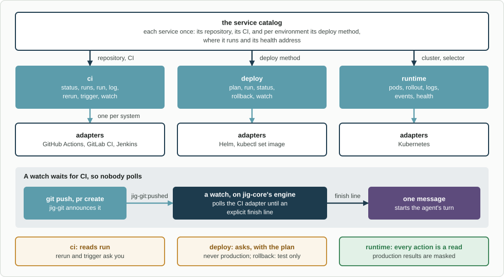

# jig-ops: build, deploy and run, on any CI and any platform

**Status: `ci`, `deploy` and `runtime` are built.** Tested against fakes on this machine; not
tried against a real CI system, cluster or address yet ([Not verified yet](docs/not-verified.md)).

`jig-ops` covers what happens after the code is written: did CI pass, can it go to a
test environment, is it healthy, and what do the logs say. You describe each service
once, in a **service catalog**, and the agent uses the same verbs whatever your CI,
deploy method and platform are. `jig-core` governs every call.

For example, "push, wait for CI, deploy 1.4.3 of `orders-api` to staging and check
it": a watch reports when CI ends, `ci log` says why if it failed, `deploy run` asks
you with the exact command, and `runtime` checks it.



*The catalog feeds three tools, each with an adapter per system. A watch waits for CI: `jig-git:pushed` starts it, and one message wakes the agent when its finish line is reached. Deploys and reruns ask you, and production is never deployed to.*

## The service catalog

In `~/.pi/agent/jig.json`, under `ops`:

```json
{
  "ops": {
    "services": {
      "orders-api": {
        "repo": "acme/orders-api",
        "ci": { "system": "github-actions", "workflow": "build.yml" },
        "environments": {
          "staging": {
            "deploy":  { "method": "helm", "release": "orders-api", "chart": "deploy/chart" },
            "runtime": { "kubernetes": { "context": "staging", "namespace": "orders", "selector": "app=orders-api" } },
            "health":  "https://api.staging.example.com/orders/health"
          }
        }
      }
    }
  }
}
```

| Field | Meaning |
|---|---|
| `repo` | Where the code lives, for finding the CI run of a commit |
| `ci` | The CI system and where it is: GitHub Actions, GitLab CI or Jenkins, with its address and sign-in |
| `environments` | Per environment: its `deploy` method, where it runs (`runtime`) and its `health` address |

- **`production` has no `deploy` on purpose.** Without `deploy`, the agent cannot
  deploy to an environment.
- **An unknown field is an error,** and the tools then do nothing until it is fixed
  (`/jig` lists the problems).
- **An environment's name is also the name `jig-core` knows it by,** and an unknown
  name counts as production, so define your test environments in `jig.json`.

All fields (and how CI watches poll): [The catalog](docs/catalog.md).

## Tools

### `runtime`

| Action | Kind | What it does |
|---|---|---|
| `pods` | read | A service's pods: ready, status, restarts, age, version |
| `rollout` | read | The workload and a verdict: `Running`, `Still rolling`, `Failing`; `waitFor` waits for a version |
| `logs` | read | The last lines of one pod's log, or of its previous run |
| `events` | read | Recent events about the service's objects, such as failed scheduling |
| `health` | read | A `GET` on the health address, or curl in a pod where the catalog says so; never a production pod |

### `deploy`

| Action | Kind | What it does |
|---|---|---|
| `plan` | read | The versions running now, the one asked for, and the exact command |
| `run` | write in the environment | Deploys a version with the environment's method. Asks you, with the plan as the preview |
| `status` | read | The last deploy run from here, and the rollout |
| `rollback` | write in the environment | Back one revision, in a test environment only. Asks you |
| `watch` | local write | Waits until every pod is ready on the version, one cannot come up, or time runs out |

### `ci`

| Action | Kind | What it does |
|---|---|---|
| `status` | read | The checks or jobs of a pull request, branch, commit or run, counted as pass, fail, pending, skipped |
| `runs` | read | Recent workflow runs, pipelines or builds, by branch, commit or state |
| `run` | read | One run's jobs and steps (GitHub also its artifacts), a pipeline's jobs, or a build's stages |
| `log` | read | A failed job's log: the tail, or the lines matching a search; capped at 400 lines and scrubbed |
| `rerun` | external write, asks | The failed jobs of a run or pipeline (GitHub also the whole run). Not Jenkins |
| `trigger` | external write, asks | A GitLab pipeline on a ref, or a Jenkins build, with parameters. Not GitHub Actions |
| `watch` | local write | Waits in the background until a finish line (the required checks, a named one, a run) |

An action or parameter the CI system of the service lacks is refused, naming the adapter ([CI](docs/ci.md)).

## Adapters

| Area | Built | Later, or added by anyone |
|---|---|---|
| CI | GitHub Actions, GitLab CI, Jenkins | Buildkite, CircleCI |
| Deploy | Helm, `kubectl set image` | A GitOps pull request, a CI deploy job, Argo CD, Flux, platform CLIs |
| Runtime | Kubernetes | Docker Compose, ECS, Cloud Run |

## Rules

- **Reads run.** Reruns, triggers, deploys and rollbacks ask you. Writes to production
  are denied by the floor, and production reads are masked. The CI host is `external`
  unless the catalog names its environment.
- **Arguments, never a shell.** `gh`, `kubectl` and `helm` get their repository, context,
  namespace, release, chart and values from the catalog, never from the model. So do
  GitLab and Jenkins their address, project and job.
- **A few named writes:** `helm upgrade --install`, `helm rollback`, `kubectl set image`,
  `kubectl rollout undo`, and in CI a rerun and a trigger. No delete, scale, arbitrary
  exec or port-forward. A version is checked to be an image tag.
- **Never production.** A deploy, a rollback or curl in a pod there is blocked before
  anyone is asked.
- **A preview is tied to the run.** If what runs now differs from what you approved,
  nothing is run: "changed since the preview". A command or request cut short, with an
  unknown outcome, is never sent again; the state is read once.
- **Credentials stay with you.** `gh`, `kubectl` and `helm` use their own sign-in. A
  GitLab or Jenkins token is a secret reference, a sign-in service or a transport.
- **A watch has an explicit finish line,** never "all checks"; one message wakes the agent.

## Events

- **`jig-git:pushed`** (listened to) starts a watch on the pushed commit of a service with
  that `repo` and a `ci` entry (`ops.watch.auto`). The payload is checked.
- **`jig-ops:artifact-ready`** (published) says a build, tag or release exists for a passed
  watch: `{ repo, pr?, sha, kind, ref, source }`. It was `jig-git:artifact-ready`.

## Company part (in the company plugin)

- its service catalog, test environments and "artifact ready" rules; later, its deploy
  methods, and sign-in services and transports for CI servers behind a VPN or proxy.

## Later

- More CI systems (Buildkite, CircleCI), one file each, and artifact rules per service.
- A GitOps pull request, Argo CD, Flux, ECS, Cloud Run and Docker Compose (Docker access
  is root, so with care), and a Terraform plan, as a read.
- One shared catalog for `jig-logs`, `jig-api` and `jig-mongo` too.

## Layout

```text
jig-ops/
  src/      index, catalog, values, watch (ops-rollout); runtime/ and deploy/ (kubernetes/, helm, kubectl-image);
            ci/ (the tool, the adapter interface, an adapter per system with its api and watch, request.ts, ops-ci)
  skills/   ops/ (roll out, check, read events and logs), ci/ (wait without polling, read why it failed)
  test/     fake gh, kubectl and helm on a PATH, fake GitLab and Jenkins on 127.0.0.1, a fake jig-core
```

## More detail

- [The catalog](docs/catalog.md): every field, and what is checked
- [CI](docs/ci.md): what each system can do, sign-in, previews, lost replies, watches and artifacts
- [Runtime](docs/runtime.md): the parameters, the results, health, and the Kubernetes adapter's rules
- [Deploy](docs/deploy.md): the commands, previews, the fingerprint, no resend, rollback and watch
- [Not verified yet](docs/not-verified.md): what needs a real CI system, cluster, Helm or address
