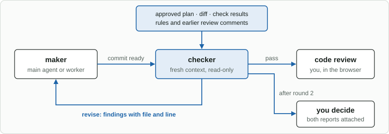

# jig-review: reviewing code in the browser

**Status: built.** Tested against a fake `jig-core`, a fake Pi and a fake authenticator on this
machine; the page is not yet tried with Windows Hello or Touch ID ([Not verified yet](docs/not-verified.md)).

`jig-review` opens a private, GitHub-style review of the agent's changes in your browser, before
anything is shared:
- a file tree;
- split or unified diffs;
- line comments, then **Ask** (one comment, now) or **Finish review** (all of them);
- **Approve**, with a passkey.

The comments reach the agent as a message, the agent answers each one, and the next round
shows what changed.

For example, after the agent changes `orders-api`, `/code-review --branch` opens everything
since the branch left the main branch. You comment on two lines and Finish review, the agent
fixes one and answers the other, and you approve the second round with Windows Hello.

## Tools

| Tool | Kind | What it does |
|---|---|---|
| `start_interactive_code_review` | local write | Opens the review in your browser, as `/code-review` does |
| `record_interactive_review_resolution` | local write | The agent records how it handled each comment |

- **`start_interactive_code_review`:** its result never contains the page link, so the agent cannot use the page.
- **`record_interactive_review_resolution`:** the answer is `fixed`, `answered` or `wont-fix`, with a small diff and the lines it
  changed.

Neither can approve. Both are declared to `jig-core`, which classifies them as local writes.

## Commands

`/code-review` takes a ticket, a folder, or one of these scopes:

| Scope | What it reviews |
|---|---|
| (none) | with an active ticket, its bound repositories' branches; otherwise the uncommitted changes |
| `--branch` | everything since the branch left the main branch (`develop`, `main` or `master`) |
| `--staged` | staged changes |
| `--unstaged` | unstaged changes |
| `--touched` | the files the agent edited last, and what it committed in that run |
| `<folder>` | only the repositories in that folder, relative to Pi's folder |
| `<ticket>` | the repositories `jig-memory` bound to the ticket, whole branch (see below) |

`/code-review settings` toggles the settings and removes a passkey. One review covers every repository
with changes under Pi's folder, with file paths that start with the repository's folder.

**Ticket scope** reads `<ticket folder>/<KEY>/ticket.json`, where `jig-memory` lists the ticket's
repositories. The folder is the `memory` section's `folder` in `jig.json`. Without bound repositories
the command says that ticket scope needs `jig-memory` with bound repositories, and guesses nothing.

After an agent run that changed files, Pi offers to review them. The files come from git, taken when the
run starts and ends, so a change counts whatever tool made it.

## Approving

Approve in the page needs proof that you are there, and the agent cannot give it. There are two ways:

| Way | What happens | Recorded as |
|---|---|---|
| **Passkey** | The page asks your device to sign a fresh challenge; the server checks the signature | `passkey` |
| **Fallback** | The page marks the review "approved in page", and Pi asks you `y` or `n` | `page-and-pi` |

A passkey is checked by Windows Hello, Touch ID or a security key. The fallback is for when no passkey is registered and you
decline to register one, or your browser has none; it counts only after `y`.

The first Approve on a machine offers to **register a passkey**. Pi then shows the key's SHA-256
fingerprint and asks you to confirm it before it is stored.
- **A passkey is a public key,** stored in `<agent folder>/jig-review/passkeys.json`, which the agent's shell does not write.
- **The settings page** lists the keys by fingerprint and removes one, confirmed in Pi.
- **[Passkeys](docs/passkeys.md)** has the checks, the store and what happens to a tampered file.

On approval the plugin:
- records it in the review store, with how and when, and the full commit of each repository when the
  approved diff is still the current one (a branch review; anything else vouches for no commit);
- emits `jig-review:approved` on `pi.events`, for `jig-workflow`'s later `review-done` condition:
  `{ reviewId, scope, ticket?, repos: [{ repo, head }], covered, files, method }`;
- tells the agent how it was approved, when the agent asked for the review.

## Rules

- **The page is local.** Served on `127.0.0.1`, on a random port, and opened at `localhost`, because a
  passkey cannot use an IP address.
- **Its link carries a per-session secret,** swapped for an HttpOnly cookie. The link goes only to you;
  a request without the cookie, or from another host or origin, is refused
  ([Server security](docs/server-security.md)).
- **Approval does not rest on the secret.** A stolen cookie can comment as you; it cannot approve.
- **Records stay out of the agent's reach.** Reviews, settings and passkeys live under Pi's agent folder.
- **Git goes through `jig-core`,** with hooks off and a repository's risky `.git/config` refused.

## Configure

`/code-review settings`, or the page's settings page:

| Setting | Default | Meaning |
|---|---|---|
| `autoAskReview` | `false` | Start the offered review without asking |
| `autoOpenBrowser` | `false` | Open the browser for it |
| `diffView` | `split` | `split` or `unified` |

## Company part (in the company plugin)

None. `jig-review` needs nothing from a company: it works on a repository's own git history.

## Later: after a checker agent



*A read-only checker agent in a fresh context reviews the change before this review (see [`jig-workflow`](../jig-workflow/README.md)): a pass goes to your code review, a revise goes back to the maker with findings, and after two rounds the decision comes to you with both reports.*

## Layout

```text
jig-review/
  src/      coordinator, store, server, tools, git sources, approval service
  src/passkey/   WebAuthn on node:crypto: CBOR, checks, challenges, the store
  web/      the page: sources, build tooling, and the built files in web/dist
  test/     one file per module, a fake authenticator and a fake Pi
  docs/     the detail pages above
```

## More detail

- [Passkeys](docs/passkeys.md): registering, approving, every check, the store, a tampered file.
- [Server security](docs/server-security.md): the link, the cookie, Host and Origin, what is served.
- [The page](docs/page.md): its parts, the build, and why `web/dist/` is committed.
- [Rounds](docs/rounds.md): comments, resolutions, the record, the event, cleanup.
- [Not verified yet](docs/not-verified.md): what needs a real browser.

## Origin

Adapted from `@dbaida/pi-interactive-code-review` (MIT).
