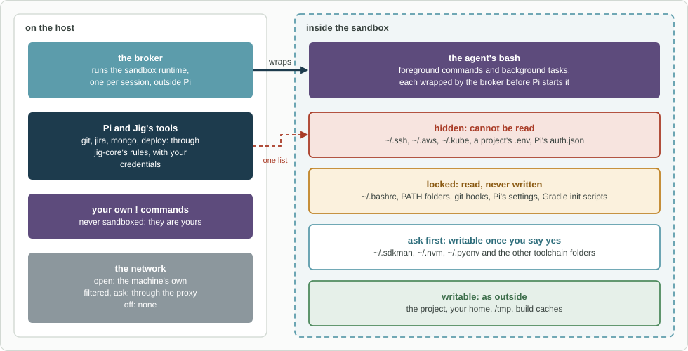

# jig-sandbox: the agent's shell, in a sandbox that stays out of the way

**Status: built, except the `filtered` and `ask` network modes, which are design.**
Built on [Anthropic's sandbox runtime](https://github.com/anthropics/sandbox-runtime) (Apache-2.0): bubblewrap on
Linux and WSL2, Seatbelt on macOS. The escape and keep-working tests run on Linux and WSL2; the macOS side is
written from the runtime's documentation and not yet tested on a Mac.

`jig-sandbox` runs the `bash` commands the agent sends inside an operating-system
sandbox, and keeps two promises:
- **the agent cannot read your credentials:** SSH keys, cloud and cluster logins,
  tokens, the secret files of your projects;
- **the agent cannot plant anything that runs later outside the sandbox:** in your
  shell start-up files, your `PATH`, git hooks, Pi's settings, build init scripts.

Everything else works as it does outside: builds and their caches, git, package
installs, the network, servers on `localhost`. When a command does hit a rule, it
says which rule and why, and offers a way through.



*Where the line runs. Your own `!` commands and Jig's tools stay outside; only what the agent runs in `bash` is inside, and the hidden paths start from the list `jig-core` protects from Pi's file tools.*

## Inside and outside

| Inside the sandbox | Outside it |
|---|---|
| The agent's `bash`, and the background tasks it starts | Your own `!` commands: they are yours |
| Subagents' `bash`, when it is the registered tool | Jig's tools (`git`, `jira`, `mongo`, ...), through `jig-core`'s rules |
| | Pi itself and its file tools, which `jig-core`'s protected paths cover |

## The four kinds of path

| Kind | Examples | Inside the sandbox |
|---|---|---|
| **Hidden** | `~/.ssh`, `~/.aws`, `~/.kube`, `~/.config/gh`, Pi's `auth.json`, a project's `.env`, `~/.gradle/gradle.properties`, the Windows drive | Cannot be read. Never asks |
| **Locked** | `~/.bashrc`, `~/.gitconfig`, `PATH` folders, git hooks, Pi's agent folder, a project's `.pi/extensions`, `~/.gradle/init.d` | Readable, never written. Never asks |
| **Ask first** | Toolchain managers (`~/.sdkman`, `~/.nvm`, `~/.pyenv`, ...) | Writable once you say yes |
| **Writable** | The project, your home folder, `/tmp`, build caches (`~/.gradle/caches`, `~/.m2/repository`, `~/.npm`) | As outside |

Hidden and locked are exact lists that start from `jig-core`'s protected paths, so the
file tools and `bash` cannot disagree, and everything not on them is writable. Every
entry and its reason is in [The rules](docs/rules.md).

## When a command hits a rule

- **It says why, and what to do instead.** For example: `cannot read ~/.ssh: it holds
  credentials. Use the git tool for fetch, pull and push; it signs in outside the
  sandbox.`
- **A folder that is not locked asks you.** If a command was stopped from writing
  `~/.sdkman`, Pi asks: *allow writes there for this session, always, or no?* Say yes
  and the agent runs it again. With no screen to ask on, the answer is no.
- **Git config keeps working.** `git config` and `git remote add` work in the sandbox.
  If a command adds a setting that would run a program outside it (`core.fsmonitor`,
  an alias starting with `!`, a filter), `jig-sandbox` takes that setting out, keeps the
  rest of the change, and says what it removed.
- **One command can run outside, if you approve it.** When the sandbox blocks
  something the agent needs and no Jig tool does it (Docker, a script that needs
  your credentials, a build that must reach a private repository), the agent asks
  to run that one command outside. You see the exact command, its folder and its
  reason, and answer: once, this exact command for the session, or no.
- **Your own `!` commands are never sandboxed,** and `/sandbox off` turns it off for
  this session if you need to. The footer then says so.

[When a command hits a rule](docs/when-blocked.md) has every message and its way through.

## Network

| Mode | What it does |
|---|---|
| `open` (default) | The machine's own network, as outside: every host, plain DNS, `localhost` |
| `off` | No network at all, `localhost` included |
| `filtered` (design) | Through the sandbox's proxy: every public host, except cloud metadata addresses, private and `localhost` addresses, and hosts on `deny` |
| `ask` (design) | `filtered`, and a new host waits while Pi asks you: once, this session, always or no |

A mode that is not built yet means `off`, and `/sandbox` says so: a setting is never
read as a more open one. In every mode, `ssh` has no keys (they are hidden), so git
over SSH goes through Jig's `git` tool, and Unix sockets are closed, the Docker socket
included: through Docker a command could run anything as root. For Docker, the agent
asks to [run that command outside](docs/when-blocked.md#running-one-command-outside).

**When to choose `off`, and later `filtered`.** In `open` mode a command can reach
anything on this machine's `localhost`, including a tunnel `jig-core` opened for a
database. If your tunnels lead to production, a mode with its own network keeps bash
away from them. A server a command starts lives as long as the command does.

## Fails closed, says so

- When the sandbox cannot start, `bash` is refused with the steps to fix it. It never
  runs unsandboxed by accident.
- `/sandbox doctor` checks each requirement and runs real commands inside to prove it:
  a write, a hidden read, a DNS lookup, a `localhost` connection.
- Without `jig-sandbox`, `bash` runs as Pi runs it, and `/jig` says plainly that
  credentials are then hidden only from Pi's file tools.

## Commands

| Command | What it does |
|---|---|
| `/sandbox` | Whether bash is sandboxed, every rule and where it came from, and this session's outside runs |
| `/sandbox doctor` | Checks the requirements and runs the proof commands |
| `/sandbox allowed` | Folders you allowed; `add <folder>` and `forget <folder>` |
| `/sandbox off`, `/sandbox on` | Turns it off or on for this session only |
| `/ps` | The [background tasks](docs/background.md): their output as it grows, and stopping one |

## Configure

In `~/.pi/agent/jig.json`, under `sandbox`. Every field is optional.

| Field | Default | Meaning |
|---|---|---|
| `share` | none | Folders writable although a rule hides them, such as a Windows work folder under `/mnt` |
| `hide`, `lock` | none | More hidden or locked paths |
| `network.mode` | `open` | `open` or `off`; `filtered` and `ask` mean `off` until they are built |
| `network.allow`, `network.deny`, `network.localhost` | none | Hosts and `localhost` ports for `filtered` and `ask`; checked now, used later |
| `env.keep` | none | Variables passed in although their names look like credentials |
| `programs` | found on `PATH` | Absolute paths of `bwrap`, `socat` and `ripgrep` when they are elsewhere |
| `background.maxTasks`, `.maxRuntimeMinutes`, `.keepFinished`, `.wake` | 4, 240, 12, `on` | Tasks at once, longest run, finished tasks kept, `off` to not wake the agent ([limits](docs/background.md#limits)) |
| `docker` | `false` | Reserved: not supported on Linux (see Network) |

## Install

Linux and WSL2: `sudo apt install bubblewrap socat ripgrep`. On Ubuntu 24.04, if the doctor
says bubblewrap cannot make a user namespace:
`sudo sysctl -w kernel.apparmor_restrict_unprivileged_userns=0`. macOS: nothing to
install, the sandbox is part of the system. Native Windows is not supported yet.

## Company part (in the company plugin)

Hosts to deny (production databases) and to allow in `ask` mode, and more hidden or
locked paths, through `jig-core`'s section defaults and protected paths.

## Later

- **The `filtered` and `ask` network modes** and the `localhost` bridge that goes with them.
- **Stand-in credentials:** a command gets a placeholder, and the proxy puts the real
  value back only on the way to an allowed host, so a build can reach a private
  repository without ever seeing its token.
- Native Windows.

## Layout

```text
broker/broker.mjs   the only place the runtime runs: a plain-JavaScript child process
src/                index.ts (entry), bash.ts (the tool, and one command outside), sandbox.ts (the session),
                    rules.ts + lists.ts + repos.ts (the rules as data), audit.ts + gitconfig.ts (after a command),
                    ask.ts + allowed.ts (questions), explain.ts, env.ts, output.ts, commands.ts, doctor.ts
src/background/     the tasks: tasks.ts (start, stop, limits), notify.ts (waking), patterns.ts, logfile.ts + output.ts
                    (the log and its reading), process.ts + sessions.ts (stopping, crash clean-up), tools.ts, ps.ts
test/               rules as data, and the escape and keep-working tests in the real sandbox
```

## More detail

- [The rules](docs/rules.md): every hidden, locked and ask-first path, and why
- [When a command hits a rule](docs/when-blocked.md): the messages, the prompts, the ways through
- [Background tasks](docs/background.md): the tools, limits, waking, `/ps`
- [Design](docs/design.md): how it is built, what the earlier sandbox taught us, the tests
