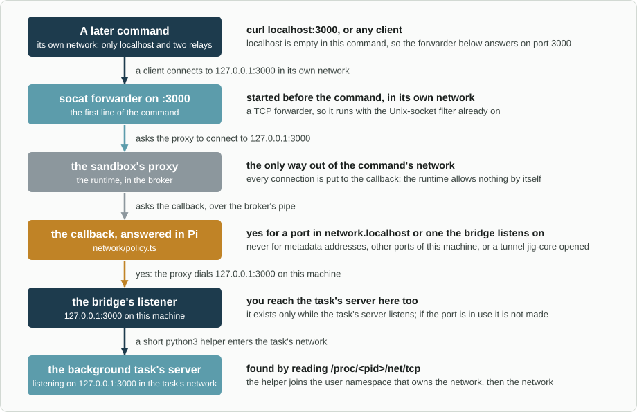

# Design

How `jig-sandbox` is built, what the earlier sandbox and a spike on a real machine
taught, and how it is tested. Back to the [jig-sandbox overview](../README.md).

## Principles

1. **Two promises, held hard.** The agent's shell never reads a credential, and never
   writes anything that runs later outside the sandbox. Configuration cannot bend
   them: `share` cannot open a hidden credential path.
2. **Everything else works as outside.** The default is writable, with exact lists of
   what is hidden or locked, because an allow-only sandbox breaks every tool that keeps
   state in a folder nobody thought to list.
3. **No dead ends.** Every block names its rule, its reason and the way through. A
   folder that is not locked asks you instead of refusing.
4. **Fail closed, say so.** If the sandbox cannot start, bash is refused, never run
   bare by accident; when the plugin is not installed, Jig says bash is not sandboxed.
5. **Test against the real machine.** Rules are tested as data, and escapes by running
   real commands in the real sandbox.

## How it fits together

```text
agent calls bash
  -> jig-core's rules (bash: local write, allowed; with outside: true it asks)
  -> jig-sandbox's bash tool: Pi's createBashToolDefinition with operations of its own
       (Pi's BashSpawnHook is synchronous and wrapping a command is not)
       rules   = jig-core's protected paths + the lists + your config + your approvals
       before  = snapshot of locked paths that do not exist yet, hooks, .git/config
       wrapped = the session broker wraps the command (sandbox runtime)
       env     = the session environment, credentials removed
  -> Pi's local operations run the wrapped command in the project; output streams as usual
  -> after: the broker cleans up after the command
            audit: locked paths created, new hooks, program-running git settings -> undone, reported
            blocks explained: network from the runtime's records, files from the error lines
            an ask-first folder was refused -> Pi asks you -> the rules widen
  -> output cleaned (escape codes), scrubbed (credential values), capped (Pi's limits)

agent calls bash with background: true
  -> the same rules, then Pi's side starts the wrapped command in a process group of its own
  -> its output is cleaned, logged under the agent folder, matched against the patterns
  -> an event (ended, ready, error) becomes one message that wakes the agent
  -> in filtered and ask, the bridge carries the ports the task listens on
```

### The broker: the runtime never runs inside Pi

The sandbox runtime runs in a small Node process, one per Pi session, that
`jig-sandbox` starts at session start and stops at shutdown. Pi asks it over a pipe
to wrap each command, then spawns the wrapped command itself. The spike showed why:
- **No stray files in your repository.** The runtime's built-in protections are
  placed relative to the working folder of the process running it, and for names that
  do not exist (`.bashrc`, `.vscode`, `.claude`) it creates empty placeholder files
  there until the command is cleaned up. Inside Pi that folder is your project, where
  `git status` would show them and `git add -A` could commit them. The broker's working
  folder is the session's private folder, so they land there. `jig-sandbox` lists the
  project's own sensitive files itself.
- **Signals stay Pi's.** The runtime installs `SIGINT` and `SIGTERM` handlers that
  reset it and keep the process alive. In the broker that is harmless; in Pi it could
  keep a closed session running.
- **A failure stays contained.** If the runtime throws or hangs, the broker is
  restarted and the command refused; Pi is unaffected.

The broker is started with the Node that runs Pi, from the plugin's own files, and
its pipe is private to the Pi process. It holds no credentials.

The programs the host runs for the sandbox (bubblewrap, `socat`, ripgrep, and `python3` for the
bridge) come from `sandbox.programs` when set, and otherwise from `PATH`, but only from a place a
command in the sandbox cannot write, following links: a copy in a project's `bin` folder could have
been planted there, and would run outside the sandbox. With only such copies, the program counts
as not installed.

### Pinned, and upgraded on purpose

`@anthropic-ai/sandbox-runtime` is pinned to an exact version at least two weeks old;
it is still `0.0.x`. An upgrade is its own change, with the escape tests run on it.

## Mapping the rules onto the runtime

| Rule | Runtime setting |
|---|---|
| Hidden | `filesystem.denyRead`, as literal absolute paths, with symbolic links resolved first; computed from your real home folder (the password database's), not `$HOME`, because `ssh` and Java use that one |
| Writable by default | `filesystem.allowWrite`: your home folder, the working folder (also when outside home), `/tmp`, the session's private temporary folder, `share` |
| Locked | `filesystem.denyWrite`, which wins over `allowWrite` |
| Ask first | `filesystem.denyWrite` until you approve, then left out of it |
| `/mnt/wsl/resolv.conf`; `share` under a hidden path | `filesystem.allowRead` (and `allowWrite` for `share`), always on the real file, never on a link to it: an allowed link binds its target's content at the link's place |
| `.git/config` writable | `filesystem.allowGitConfig: true`, with the audit below |
| Unix sockets closed | the runtime's socket filter (seccomp), which blocks making a Unix socket at all. `allowAllUnixSockets` is never set: on WSL it would let a command start Windows programs. The runtime cannot allow one socket by path on Linux, so `docker: true` is not supported: Docker goes through [running a command outside](when-blocked.md#running-one-command-outside) |
| Network `open` | no `network.allowedDomains` at all: the runtime then leaves the network namespace alone |
| Network `filtered`, `ask` | `allowedDomains: []`, no `strictAllowlist`: the proxy asks the callback, the only thing that allows a host |
| Ports carried into each command | a `socat` per port on the first line of the command, which asks the proxy for `127.0.0.1:<port>` (below) |
| Network `off` | `allowedDomains: []` with `strictAllowlist`: the command gets a network namespace with nothing in it |
| Temporary folder | the runtime's temporary folder variable set to the session's private folder for the broker (its default, `/tmp/claude`, does not exist on most machines); in `open` mode the runtime sets no `TMPDIR` for the command, so the plugin sets it |
| Every path | `{ path, literal: true }`, absolute, links followed, only when the path exists; a deny for a path outside every writable folder is left out, since it is read-only already |
| Credentials in the environment | the command is started with a copy of Pi's environment without them, and the runtime's `credentials.envVars` removes the same names a second time |

Runtime limits that shape the rules:
- **Literal paths only on Linux** for write rules, and a rule for a path that does not
  exist does nothing. So rules are computed from what exists when the command is
  wrapped, and the audit covers what a command creates.
- **A hidden directory** appears empty inside; a hidden file appears empty.
- **Name resolution in `filtered` mode** happens in the proxy, on the host: HTTP
  clients work, while `dig`, `getent` and programs that ignore proxy settings find no
  names. `open` mode has plain DNS.

## Network

### `open`: the machine's network

The command shares the machine's network namespace, as in the earlier harness:
servers it starts are reachable by later commands and by you, `localhost` services
work, and DNS is plain. Two consequences, stated in the README: the cloud metadata
address cannot be blocked, and a tunnel `jig-core` opened on `localhost` is reachable.

### `filtered` and `ask`: through the proxy

Each command gets a network namespace of its own with nothing in it but two relays to the
runtime's proxy. The proxy asks a callback about every connection. The callback runs in the
broker, which is the runtime's process, so it sends the question over its pipe to Pi, where
[`network/policy.ts`](../src/network/policy.ts) answers; a failure or a silence is a refusal.
- **Always refused:** cloud metadata addresses and names (`169.254.169.254`, `fd00:ec2::254`,
  `metadata.google.internal` and a few more), and loopback, link-local, private (RFC 1918),
  carrier (100.64.0.0/10) and this machine's own addresses, except a port in
  `network.localhost` or one a task's server is carried on (below). The spike showed that an
  approved IP address is dialled with no further check, so the callback does it. An address
  that wraps another (`::ffff:127.0.0.1`, NAT64, 6to4) is judged by what it wraps.
- **A name that resolves to such an address** is refused by the runtime's own check, since the
  callback sees only the name; the line says `resolved to a loopback address`.
- **Spelled to be read as an address:** `2130706433`, `0x7f000001` and `127.1` are not host
  names, and are refused, since a program may read them as `127.0.0.1`.
- **`deny`:** refused, with the entry that matched in the reason.
- **`filtered`:** every other host is allowed.
- **`ask`:** a host in `allow` or in your kept answers is allowed; any other asks you, while
  the connection waits (see [Asking you](#asking-you)).

`allow` and `deny` exist only in these two modes. In `open` there is no proxy and nothing reads
them, so a `deny` list there refuses nothing: `/sandbox` (a note, from the check made when the
sandbox starts) and `/sandbox doctor` say so. In `off` there is no network to refuse.

`allow` and `deny` are read by the callback and not given to the runtime. A host that
the runtime's own list decides is not checked for a private address, and an entry such as
`10.0.0.5` in `allow` would have opened one.

A refusal travels as the reason in the proxy's `403` (a client prints it) and as a
`[sandbox] cannot reach host:port: ...` line after the command's output.

### `localhost` across commands, in `filtered` and `ask`

Separate namespaces mean a server in one command is not at `localhost` in the next.
`jig-sandbox` carries two kinds of port across, on Linux and WSL2:
- **A port a background task listens on.** The bridge reads the task's namespace from
  `/proc/<pid>/net/tcp` and `tcp6` about once a second and before each command. For each
  port it opens a listener on this machine's loopback at the same port, so you reach the
  server there too. A connection to that listener enters the task's namespace and dials the
  server (a short `python3` helper does the entering, since Node cannot).
- **A port in `network.localhost`:** a service on this machine, such as a local database.
- **In each later command,** a `socat` on the first line of the command listens on the same
  port in the command's own namespace and asks the proxy to connect to `127.0.0.1:<port>`.
  The callback allows exactly the carried ports on the loopback address, so the proxy
  reaches the listener. This needs TCP only, so it runs after the command's Unix-socket
  filter is on.
- **`jig-core`'s tunnel ports are never carried** unless listed: a port is allowed only
  while one of the bridge's own listeners is on it. If the machine already uses the port (a
  tunnel does), the listener cannot start, the task is told so, and the port stays refused.
- **Why not a Unix socket per port:** the runtime ignores `allowUnixSockets` on Linux (its
  filter cannot look at a path), and `allowAllUnixSockets` is never set. On macOS the option
  exists, but `filtered` and `ask` are treated as `off` there until the bridge is tried on a
  Mac.
- **Without `python3`** a task's server is not carried, `/sandbox` and the doctor say so,
  and `network.localhost` ports still work.



*How a later command reaches a background task's server in `filtered` and `ask` mode.*

## The audit after each command

What the runtime cannot prevent, `jig-sandbox` undoes and reports:
- **A locked path that did not exist** (`~/.zshrc` on a machine without zsh, a Gradle
  `init.d` script folder): created during the command, it is removed.
- **Hooks in a repository the command created:** a repository made by `git init`
  inside the command has no protection until the next command, so new files in any
  watched repository's `.git/hooks` (other than the `*.sample` files) are removed.
- **Program-running git settings:** each watched repository's `.git/config` and
  `config.worktree` are compared with the snapshot; new keys from the list in
  [When a command hits a rule](when-blocked.md#git-configuration) are taken out, and
  the rest of the change stays.

- **A locked link removed and made again as a file** (`rm ~/.bashrc; echo ... > ~/.bashrc`
  when `~/.bashrc` is a link to a dotfiles repository): the runtime mounts what a link
  points at, so the link itself is not protected. It is put back.
- **A new `*.pth` file** in your user site-packages, which Python runs at every start.

Watched repositories are the working folder's, the repository around it, and those one
and two levels below it. Each removal is one line to the agent and a notice to you, and
what was taken away is moved to `<agent folder>/jig-sandbox/removed`, not deleted. The audit
also runs for a command that was aborted or timed out.

## Explaining a block

- **Network:** the runtime records each refusal with its host and reason, read by
  command id.
- **Files:** the runtime does not record file refusals. `jig-sandbox` reads the
  command's error lines (`Read-only file system`, `Permission denied`, `Device or
  resource busy`, `No such file or directory` for hidden paths), takes the paths they
  name, and matches them against the rules. A path it can match gets its rule and way
  through; otherwise one general line points at `/sandbox`.
- **Ask first:** a refused write whose path is under an ask-first folder raises the
  question; several for the same folder are one.

## Asking you

Every question goes through `jig-core`'s approval queue (`approvals.inTurn`), so two
questions never overlap, whether they are about a write, a host or one of `jig-core`'s own.
Without `jig-core` they wait in a queue of this plugin's own.
- **Writes:** after the command, inside the waiting tool call, as every Jig approval is. The
  answer widens the rules from the next command; the agent is told to run it again.
- **Hosts:** in `ask` mode, during the connection, with four answers. *Once* allows that host
  and port for 15 seconds, so a command that opens several connections asks once; *This
  session* until Pi ends; *Always* is kept; *No* refuses with the reason in the refusal.
  Connections to one host and port that arrive while the question is open share it, and the
  question closes itself, as a no, after two minutes.
- **No screen:** the answer is no, and the line says how a person allows it.
- **Kept answers:** `<agent folder>/jig-sandbox/allowed.json`, which Pi's file tools and the
  sandbox can only read. `/sandbox allowed` lists folders and hosts, and `add` and `forget`
  change them.

## Environment

- **Set:** `TMPDIR` is the session's private temporary folder (in `open` mode the runtime sets
  none), and a `PATH` entry under a hidden folder, such as the Windows part on WSL, is dropped,
  since nothing in it can run.
- **Removed:** variables whose names look like credentials, matched without regard to
  case: `*TOKEN*`, `*SECRET*`, `*PASSWORD*`, `*PASSWD*`, `*_KEY`, `*APIKEY*`,
  `*CREDENTIAL*`, `AWS_*`, `AZURE_*`, `GOOGLE_APPLICATION_CREDENTIALS`, `GH_*`, `GITHUB_*`,
  `NPM_TOKEN`, `VAULT_*`, `KUBECONFIG`, and the sockets `SSH_AUTH_SOCK`, `GPG_AGENT_INFO`,
  `DBUS_SESSION_BUS_ADDRESS`, `WSL_INTEROP`. `env.keep` passes a named one through.
- **Scrubbed from output:** the values of the removed variables, and every secret
  `jig-core` resolved this session.
- **Added by the runtime** in `filtered` mode: the proxy variables, `JAVA_TOOL_OPTIONS`
  with its Java proxy agent (Gradle and Maven then use the proxy), and a
  `GIT_SSH_COMMAND` for its proxy.

## What jig-core gains

| Addition | Use |
|---|---|
| `jig().protectedPaths.list()` | The sandbox reads the protected paths, with kind and source, so both share one list |
| `jig().sandbox.register(provider)` | The sandbox says it is active, in which mode, why not when it is not, and answers `canWrite(path)` |
| `exec.run` checks `canWrite` | A program in a folder the sandbox lets bash write is refused, found on `PATH` or by absolute path, so a planted `git` never runs outside |
| `/jig` and session start | Say whether bash is sandboxed, and in which network mode; a plain warning when there is no sandbox |
| `sandbox.canRun` and `sandbox.run(command, options)` | Another plugin runs a shell command with the wrapping of `bash`, without the tool: `jig-workflow` runs a repository's tests this way. With the sandbox off, unstarted or refusing, it rejects and nothing runs elsewhere |
| `bash` action `outside` | Classified as a local write that asks; allowed without asking only by a rule naming `bash`, action `outside` and a command pattern; refused with no screen; recorded |
| A rule's `command` | A pattern for the call's `command`, whose `*` does not reach across `;`, `&`, `\|`, `<`, `>`, a backquote, `$(` or a line break |
| A preview's `answers` | The words on the three buttons, so the dialog says `Run once` and not `Allow` |
| A declaration's `extendsDefaults` and `examples` | `bash` is classified only for `outside`; the rest stays with the user's rules and the built-in default. `/jig rules` shows the action |

## What the earlier sandbox and the spike taught

| What happened | What this design does |
|---|---|
| A `PATH` folder that did not exist made bubblewrap stop every command | Rules only for paths that exist; nothing mounted or created in other programs' folders; a start-up probe runs a real command with your real environment |
| Hiding the Windows drive broke name resolution on WSL | `open` keeps plain DNS; `/mnt/wsl/resolv.conf` stays readable; the doctor resolves a name |
| A read-only `.git/config` broke `git config` and `git remote add` | Writable, with program-running settings audited away |
| A protected `.pi` stopped the agent keeping `.pi/docs` current | Only what Pi loads is locked |
| Read-only toolchain folders stopped JDK and Node installs | They ask first |
| Gradle could not lock its wrapper download | Gradle's folders are writable; only its init scripts and credentials are not. A Gradle build ran in the spike, with its proxy agent |
| The agent rewrote code with scripts in bash, out of sight of reviews | The bash description says to change code with `edit` and `write` |
| October audit: project `.pi/extensions` and git hooks were writable | Both locked, plus the audit for repositories made during a command |
| Spike: the runtime's placeholders appeared in the project | The broker |
| Spike: `HOME` does not redirect `ssh`, which used the real keys | Hidden paths come from the real home folder |
| Spike: an approved IP address skips the runtime's address checks | The callback refuses private and local addresses itself |
| Spike: a separate network per command | `open` shares the machine's; the bridge in `filtered` |
| Spike: file refusals are not recorded | Explained from the command's error lines |

## Performance

From the spike on WSL2: starting the runtime takes about 130 ms, once per session.
Each command adds about 45 ms (13 ms to wrap, the rest to start the sandbox), and
about 18 ms more in a working folder of 20,000 files. Twenty commands in parallel ran
without errors.

Measured on the built plugin, on the same machine through the whole path (the rules for
the command, the broker, the sandbox, Pi's own bash tool and the explanations), for `true`
in a small folder:
- **Session start:** about 0.7 to 0.9 s, in the background: the broker process (loading the
  runtime is most of it), the runtime, and a test command. A command sent earlier waits.
- **Each command:** a median of 60 to 90 ms with a machine that is busy, against 4 to 11 ms
  for a bare `bash -c true`. The rules take 8 to 25 ms of that.
- **Twenty at once:** about 0.9 s, and none failed.
- **`filtered` and `ask`** (the same machine, a quiet moment): a command takes a median of
  78 ms where `open` takes 51 ms, the cost of its own network and the two relays. Each carried
  port adds about 4 ms to every command (a forwarder starts and the command waits until it
  listens): 82 ms with one, 90 ms with three. A new connection through a forwarder and the
  proxy adds about 30 ms; one from this machine to a task's server through the listener and
  the helper takes about 26 ms; one from a later command to a task's server, through all of
  it, about 50 ms. A server that keeps its connections open pays this once.
- **Resolving paths** is what costs on WSL: the Windows part of `PATH` takes seconds to
  resolve cold. Folders under a hidden folder are skipped, and far-away paths are remembered
  for half a minute.

## Tests

- **Rules as data:** for a given home, working folder and environment, the computed
  runtime configuration, with links, missing paths, WSL and macOS layouts, company
  additions and your config (`rules.test.ts`, on a file system made in memory).
- **Escapes, run for real** in the real sandbox, with fake credentials made at run
  time in a fake home (`escapes.test.ts`). Each must fail: read `~/.ssh/id_*`,
  `~/.aws/credentials`, Pi's `auth.json`, a project `.env` (also through a symbolic link,
  made before or in the same command); write `~/.bashrc`, a missing `~/.zshrc` (audited
  away), `~/.gradle/init.d/x.gradle`, `.git/hooks/pre-commit` (also in a repository made
  in the same command), `.pi/extensions/x.ts`, a program into a `PATH` folder, Pi's agent
  folder; set `core.fsmonitor` (audited away); connect to a Unix socket; read the Pi
  process's environment through `/proc`; run a Windows program on WSL; create a user
  namespace. In `filtered` and `ask`: reach the cloud metadata address and this machine's
  loopback and private neighbours through the proxy (also with the address spelled as a
  number), reach a service on this machine or a tunnel that is not listed, and make a Unix
  socket with the forwarders running. The rules of every test also hide the real home's
  credential places, and a test never reads a file under it.
- **Keeps working, for real** (`keep-working.test.ts`): a Gradle build, `npm install` of a
  local package, `git init/add/commit/branch/config/remote add`, a connection to a server
  on `localhost` in `open` mode and none in `off`, twelve commands at once, and no file
  left in the project that the command did not write. In `filtered` and `ask`
  (`network-real.test.ts`): a host reached through the proxy, a listed port and a plain TCP
  exchange through its forwarder, two commands that each start a server on the same port,
  twelve commands at once, `git`, and a task's server reached by a later command and by the
  machine. They use a loopback alias as the "public host", so none needs the internet.
- **The network modes** (`network-*.test.ts`): the address ranges and the odd spellings, the
  policy's decisions, the four answers and what each remembers, the listener and the
  forwarders without namespaces, and the broker's question and Pi's answer through the plugin.
- **Background tasks** (`background*.test.ts`): the patterns that are refused, a burst of
  events as one message, the limits on error floods, one message in flight, paging and
  rotation of the log, stopping against a fake process table, the clean-up of a crashed
  session, and the tools, `/ps` and the footer with real processes. In the real sandbox: a
  task has the rules of a command, its tree stops (children inside bubblewrap included), its
  trap runs on the polite stop, and the end of the session leaves nothing running.
- **The whole path:** the plugin in a fake Pi with the real broker and the real runtime;
  the broker is started and stopped, and Pi's signal handling is untouched.
- **CI:** Ubuntu 24.04 with bubblewrap, `socat` and ripgrep installed and unprivileged user
  namespaces on runs all of it on every push. In CI a missing program fails the tests;
  on a machine without them they skip with the reason.
- **Locally,** `JIG_SANDBOX_TEST_BWRAP`, `JIG_SANDBOX_TEST_SOCAT` and `JIG_SANDBOX_TEST_RG`
  name the programs when they are not on `PATH`. The network tests also need `python3`.

## Build order

1. **Built:** the broker, rules, bash tool, environment, explanations, `/sandbox`, the
   doctor, the `jig-core` additions, and the `open` and `off` network modes.
2. **Built:** the audit, and asking you (writes). Running one command outside is built
   with it.
3. **Built:** background tasks and `/ps`.
4. **Built:** `filtered` and `ask`, with the callback and the `localhost` bridge.

Each step ships with its escape and keep-working tests.

## What building it changed

| The design said | What is so |
|---|---|
| `docker: true` opens the Docker socket | The runtime cannot allow one Unix socket by path on Linux, and `allowAllUnixSockets` is never set. `docker` is reserved; the agent runs Docker through `outside` |
| A spawn hook wraps the command | Pi's hook is synchronous; the tool is Pi's own definition with operations that wrap first |
| macOS needs `brew install ripgrep` | The runtime uses ripgrep on Linux only; macOS needs nothing |
| `filtered` and `ask` are modes | Built on Linux and WSL2. On macOS they mean `off` and `/sandbox` says so, since the bridge is untried there |
| A moved-aside folder could replace a locked file | The kernel refuses to move a folder that holds a mounted path; what can be replaced is a locked link, which the audit puts back |
| `PATH` folders are locked | Those in your home folder, outside the working folder |
| The question about a host shares `jig-core`'s queue | Done through a new `jig-core` call, `approvals.inTurn`; the question about a write uses it too, so nothing overlaps |
| A server started by a command is reachable by the next one | A command ends with its processes. A server that must outlive it is a [background task](background.md) |
| Task logs are in a private folder of the session | They are under `<agent folder>/jig-sandbox/background`, which the sandbox cannot write: in `/tmp` a command could swap a log for a link to a file Pi can read and it cannot, and `bg_output` would show it |
| Background tasks start through the same path as `bash` | Pi's side starts them itself, to own the process group and the pipes, and wraps them with the same rules; a task's output is cleaned and its credential values taken out before it is written |
| A task wakes the agent on text it prints | The patterns are regular expressions, checked first for the constructs that make matching slow |
| A Unix socket per carried port, through the runtime's option for named sockets | The runtime ignores that option on Linux. A forwarder asks the proxy for `127.0.0.1:<port>` over TCP; the callback allows the carried ports |
| `network.localhost` opens loopback, link-local, private and the machine's own addresses | It opens loopback and the machine's own addresses at that port. Other private hosts, link-local and carrier addresses stay refused |
| Entering a task's network from the host | `nsenter` fails: no process is in the user namespace that owns it. A `python3` helper joins that one, then the network |
| `Once` allows the connection | It allows that host and port for 15 seconds, since a command opens several connections |
| `allow` and `deny` go to the runtime | They are read by the callback, so a listed address is still checked for a private range |
