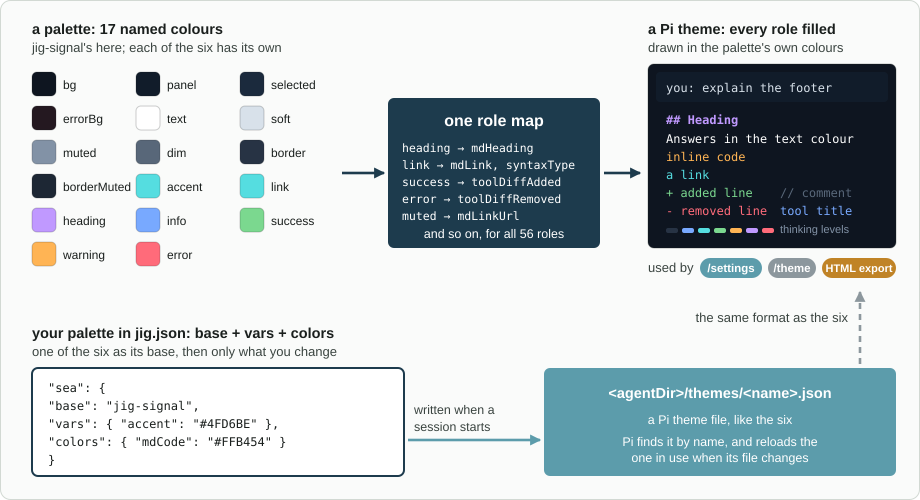

# jig-theme: palettes, a footer, and your own colours

**Status: design.**

`jig-theme` changes how Pi looks, and nothing else. It brings:
- **six palettes,** shipped as ordinary Pi themes, so they appear in Pi's
  `/settings` next to `dark` and `light`;
- **your own palettes,** written in `jig.json` as a few colours over one of
  the six;
- **a one-line footer:** model, thinking level, context size, prompt-cache
  time left, cost and tokens. You choose its parts and their order, and other
  plugins can add theirs;
- **answers in the theme's text colour,** so they stand apart from thinking.

```text
Claude Opus 5.5 · high · ctx 182k · cache 3:41 · est. $4.21 · ↑12.4k ↓3.1k
```



*How a palette becomes a theme. Each palette names about fifteen colours, and one role map spreads them over all of Pi's roles. Your own palette starts from a built-in one and changes only what you list.*

## Palettes

| Palette | Look |
|---|---|
| `jig-lime` | dark, lime with cyan and pink |
| `jig-signal` | dark, cyan with blue and violet |
| `jig-ember` | dark, amber with coral |
| `jig-orchid` | dark, violet with pink and blue |
| `jig-mono` | dark, greys with one accent, the highest contrast |
| `jig-paper` | light, dark ink on warm white |

Each palette names about fifteen colours, such as `text`, `muted`, `accent`,
`link`, `heading`, `warning` and `error`. One role map turns them into all of
Pi's roles: headings, links, code, diffs, syntax and the thinking levels. Every
palette keeps body text at a 7:1 contrast on its backgrounds, and muted text at
4.5:1. The names and the map are in [Palettes](docs/palettes.md).

## Your own palettes

Write them in `~/.pi/agent/jig.json`, under `theme`. Each one starts from a
built-in palette and changes only what you list:

```json
{
  "theme": {
    "palettes": {
      "sea": {
        "base": "jig-signal",
        "vars": { "accent": "#4FD6BE", "heading": "#C099FF" },
        "colors": { "mdCode": "#FFB454" }
      }
    }
  }
}
```

- `vars` changes the palette's named colours, and every role that uses them.
- `colors` sets single Pi roles, after the map.
- A colour is any form Pi accepts: `#4FD6BE`, `oklch(62% 0.1 200)`,
  `okhsl(250 60% 55%)`, a 256-colour index, or `""` for the terminal's own.

At session start, and on `/theme reload`, each palette is written to
`~/.pi/agent/themes/<name>.json`, where Pi finds it. Pi reloads the theme in
use when its file changes, so a change shows at once. How files are written,
and when they are left alone, is in [Your palettes](docs/your-palettes.md).

## The footer

| Part | Shows |
|---|---|
| `model` | The model's name. It shortens last on a narrow terminal |
| `thinking` | The thinking level |
| `context` | Context size in tokens: amber from 150k or 70% of the window, red from 250k or 90%; `ctx ?` right after a compaction |
| `cache` | Time left on the prompt cache, `cache cold` once it has expired; amber in the last minute |
| `cost` | The session's estimated cost; `est. $?` when a model has no price |
| `tokens` | Tokens in (with cache writes) and out |
| `branch`, `cwd` | The git branch and the folder name. Off by default |
| `statuses` | What other extensions set with Pi's `setStatus` |
| `plugins` | Parts other plugins add (below) |

On a narrow terminal the footer drops parts in the `dropFirst` order, then
shortens the model's name. Every part, colour and threshold is in
[The footer](docs/footer.md).

**Adding a part from another plugin.** Emit on Pi's event bus. Nothing needs
to import `jig-theme`, and nothing breaks without it:

```ts
pi.events.emit("jig-theme:segment", { id: "spend", label: "Oct $120 / $200", tone: "warning" });
```

`tone` is `normal`, `muted`, `accent`, `success`, `warning` or `error`. An
empty `label` removes the part.

## Commands

| Command | What it does |
|---|---|
| `/theme` | Lists every theme Pi has, with a colour swatch each. Moving shows it live, Enter keeps it, Esc puts back the one you had |
| `/theme <name>` | Switches to that theme and keeps it, as `/settings` does |
| `/theme reload` | Writes your palettes again from `jig.json` |
| `/theme footer on` / `off` | Shows or hides the Jig footer for this session |

## Configure

In `~/.pi/agent/jig.json`, under `theme`. Every field is optional. `jig-core`
checks the section at session start; a mistake names the key, and the defaults
apply.

| Field | Default | Meaning |
|---|---|---|
| `palettes` | none | Your palettes, above |
| `footer.enabled` | `true` | `false` keeps Pi's own footer |
| `footer.segments` | `["model", "thinking", "context", "cache", "cost", "tokens", "plugins", "statuses"]` | The parts, in order |
| `footer.dropFirst` | `["tokens", "cache", "branch", "cwd", "plugins"]` | What a narrow terminal gives up first |
| `answerColor` | `"text"` | The Pi role answers are drawn in; `false` leaves Pi's default |

The footer's colours, context thresholds, cost decimals and separator are in
[The footer](docs/footer.md#configure).

## Rules

- **Pi's own themes.** Palettes are theme files in Pi's format. They work in
  `/settings`, in Pi's HTML export, and without the rest of Jig.
- **Only files it wrote.** `jig-theme` writes and deletes only theme files it
  wrote itself and nobody has changed since.
- **Looks only.** It reads the session and the extension statuses, and writes
  only theme files. It has no tools, so the model never sees it.
- **Never in the way.** No footer in subagent children, without a terminal, or
  with `JIG_THEME_FOOTER=0`. If a Pi update changes what the answer colour
  depends on, answers keep Pi's default colour.

## Company part (in the company plugin)

- a company palette, through `jig-core`'s section defaults;
- footer defaults, such as which parts to show;
- footer parts of its own, such as the month's model spend, through
  `jig-theme:segment`.

## Layout (planned)

```text
jig-theme/
  src/      index.ts, palettes.ts (the six), roles.ts (the role map), build.ts (a palette to a
            theme), write.ts (your palettes on disk), footer.ts, segments.ts, cache.ts,
            usage.ts, answer-text.ts, picker.ts (/theme), config.ts
  themes/   the six palettes as Pi theme files, made by scripts/build-themes.ts
  test/
  docs/     the detail pages below
```

## More detail

- [Palettes](docs/palettes.md): the named colours, the role map, the contrast rules
- [Your palettes](docs/your-palettes.md): fields, names, when files are written and left alone
- [The footer](docs/footer.md): every part, the colours, narrow terminals, parts from other plugins
