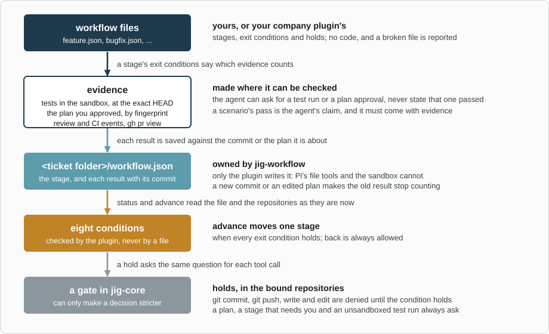

# jig-workflow: named workflows, with stages, holds and evidence

**Status: built.** Tested with the real `jig-core`, real git repositories, a fake `gh` and `glab` (on recorded GitLab
answers) and, where bubblewrap is installed, the real sandbox. `gh pr view`, `glab api` and a CI watch have not been tried
against GitHub or GitLab themselves.

`jig-workflow` takes a piece of work, such as a ticket, through a **workflow**: a named, ordered list of
stages, each with a goal for the agent and the conditions that let the work move on. The conditions are
checked against evidence the plugin can see (a test run at the exact commit, a plan you approved, a
review, a pull request), and until one holds, calls such as `git push` are held.

You write the workflows; the plugin has none built in, only examples to copy, such as `feature`
(understand → plan → build → review → deliver → accept → done), `bugfix` and `investigation`. Start one
with `/workflow start feature PROJ-123`: the agent then reads each stage's goal, asks for tests and
approvals through the `workflow` tool, and moves on when `advance` finds every exit condition met.



*From file to hold. A stage's exit conditions say which evidence counts, each result is saved against the commit or plan it is about, and the same conditions that stop `advance` make the gate hold a call.*

## A workflow file

One JSON file per workflow, named after it, such as `~/.pi/agent/workflows/feature.json`:

```json
{
  "name": "feature",
  "description": "A change to a service, from plan to acceptance on staging",
  "match": { "ticket": "^PROJ-\\d+$" },
  "stages": [
    { "id": "plan", "goal": "Write plan.md with numbered acceptance scenarios", "exit": ["plan-approved"] },
    { "id": "build", "goal": "Change the code and test it", "exit": ["tests-pass-at-head"] },
    { "id": "done" }
  ],
  "holds": [
    { "until": "plan-approved", "calls": ["git commit", "git push", "write", "edit"] },
    { "until": "tests-pass-at-head", "calls": ["git push"] }
  ]
}
```

A hold denies the listed calls, with a reason that names the condition, until it holds. `write`, `edit`,
`git` and `pr` are held only in the work's bound repositories. Three finished examples (`feature`,
`bugfix`, `investigation`) are in [`examples/`](examples/); every field is in [Files](docs/files.md).

## Conditions

A fixed list, checked by the plugin itself, so a file never runs code. Each is decided from evidence, as
[Conditions](docs/conditions.md) says.

| Condition | Holds when |
|---|---|
| `notes-updated` | The ticket's notes changed since the stage began (see `jig-memory`) |
| `plan-approved` | You approved this exact `plan.md`; an edited plan needs approving again |
| `tests-pass-at-head` | Each bound repository's tests passed, in the sandbox, at its current HEAD |
| `review-done` | A `jig-review` approval covers each bound repository's current HEAD |
| `pull-request-open` | Each bound repository's branch has an open pull request (a merge request on GitLab) |
| `checks-pass` | The pull request's head is HEAD, and its checks passed (a CI watch, or the checks `gh` or `glab` show) |
| `scenarios-pass` | Every numbered scenario of the approved plan passed, each with evidence |
| `you-approve` | You answer yes to moving on, in a dialog |

## Tool: `workflow`

| Action | Kind | What it does |
|---|---|---|
| `list` | read | The workflows defined, and the files that failed to load |
| `status` | read | The stage, what each exit condition still needs, the holds in force; without a ticket, all active work |
| `start` | local write | Starts a workflow for a ticket; replacing one needs `replace` and asks you |
| `bind` | local write | A worktree for a repository on the work's branch, added to the ticket's repositories |
| `submit-plan` | local write, asks | Checks `plan.md` and shows it for your approval, with a fingerprint |
| `test` | local write | Runs a bound repository's tests at HEAD, in the sandbox, and records the result |
| `scenario` | local write | Records pass or fail for one numbered scenario; a pass needs evidence |
| `advance` | local write | Moves one stage when every exit condition holds, or lists what is missing |
| `back` | local write | Moves to an earlier stage; always allowed, and nothing recorded is erased |

## Commands

| Command | What it does |
|---|---|
| `/workflow` | The status of this session's work |
| `/workflow list` | The workflows defined, and every file that failed to load, with the reason |
| `/workflow start [name] [ticket]` | Starts a workflow; replacing one says what is lost and asks |
| `/workflow reload` | Reads the workflow files again |

At session start, a line says which stage the active ticket is in and what is missing.

## Rules

- **Nothing is built in.** Workflows are read from files at session start and on `/workflow reload`.
- **One workflow per ticket.** Switching is an explicit `start` that lists what is lost; the old state is kept.
- **Holds go through `jig-core`.** The plugin registers a gate, which can only make a decision stricter
  (allow to ask or deny, ask to deny); the floor still applies ([Holds](docs/holds.md)).
- **Evidence is recorded against what it is about.** A new commit ends a test result, and an edited plan
  needs approving again ([State](docs/state.md)).
- **Tests run in the sandbox.** Without `jig-sandbox` a test run asks first, naming the commands
  ([Tests](docs/tests.md)).
- **The agent cannot mark anything passed.** It asks for a run, an approval or a check, and the plugin
  records the outcome in a file that Pi's file tools and the sandbox cannot write.
- **A broken file is reported, not guessed.** A file with an unknown field, condition or stage is skipped,
  and `/workflow list` names the file and the key.

## Configure

In `~/.pi/agent/jig.json`, under `workflow`. Every field is optional.

| Field | Default | Meaning |
|---|---|---|
| `folders` | none | More folders to read workflow files from: absolute, or starting with `~/` |
| `tests` | by build file | A test command per repository: a name or path pattern, then a command or `{ command, timeoutSeconds }` |
| `testTimeoutSeconds` | `900` | How long one test run may take, from 10 to 7200 |

```json
{
  "workflow": {
    "tests": { "orders-api": "./gradlew test", "libs/*": { "command": "npm test", "timeoutSeconds": 300 } }
  }
}
```

Files are read from `folders`, then `~/.pi/agent/workflows/`, then the project's `.pi/workflows/` once Pi
trusts the project; a later file with the same name wins. Defaults per build file (`gradlew`, `pom.xml`,
`package.json`, ...) are in [Tests](docs/tests.md).

## Company part (in the company plugin)

- its workflow files, in a folder given through `config.addSectionDefaults("workflow", { folders })`, with
  their ticket key patterns and branch naming;
- its test commands per repository, through the same section defaults.

## Later

- **Check tiers,** a **checker agent**, a **review-comment ledger** and **one approval per change**
  ([Design](docs/design.md#where-this-comes-from)).

## Layout

```text
jig-workflow/
  src/        index.ts (the factory), runtime.ts (the session), config.ts, definition.ts + load.ts (workflow files),
              store.ts (workflow.json), ticket.ts + repos.ts, conditions.ts + sources.ts + listeners.ts (evidence),
              plan.ts, tests.ts, gate.ts (holds), tool.ts + actions.ts, commands.ts, status.ts, host.ts (jig-core's
              programs and sandbox, behind one seam)
  skills/     workflow/SKILL.md: how to take work through its workflow
  examples/   feature.json, bugfix.json, investigation.json
  test/       one file per module; world.ts runs a whole session through the real jig-core
```

## More detail

- [Files](docs/files.md): fields, matching, folders, examples, a company's files
- [Conditions](docs/conditions.md): how each one is decided, and what makes a result stop counting
- [Holds](docs/holds.md): the gate, what a hold matches, calls that always ask
- [Plan](docs/plan.md): `plan.md`, the approval, scenarios and their evidence
- [Tests](docs/tests.md): commands per repository, the sandbox, what is recorded
- [State](docs/state.md): `workflow.json`, switching, protection, concurrent sessions
- [Design](docs/design.md): how it is built, what it adds to other plugins, the tests
