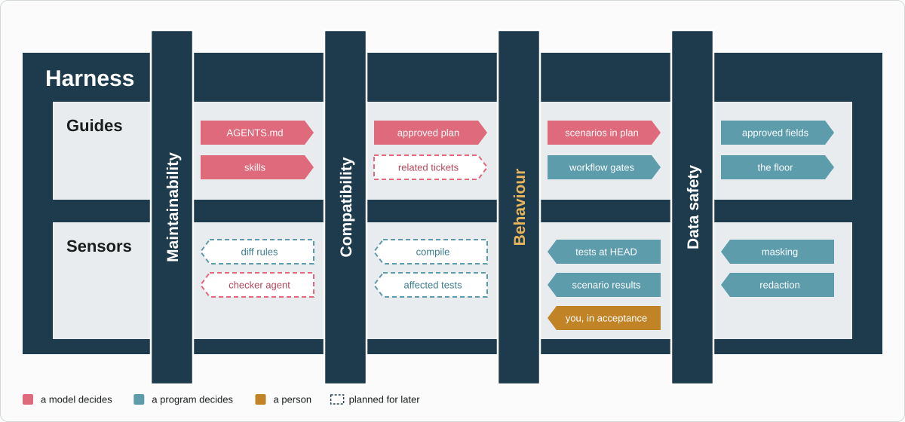
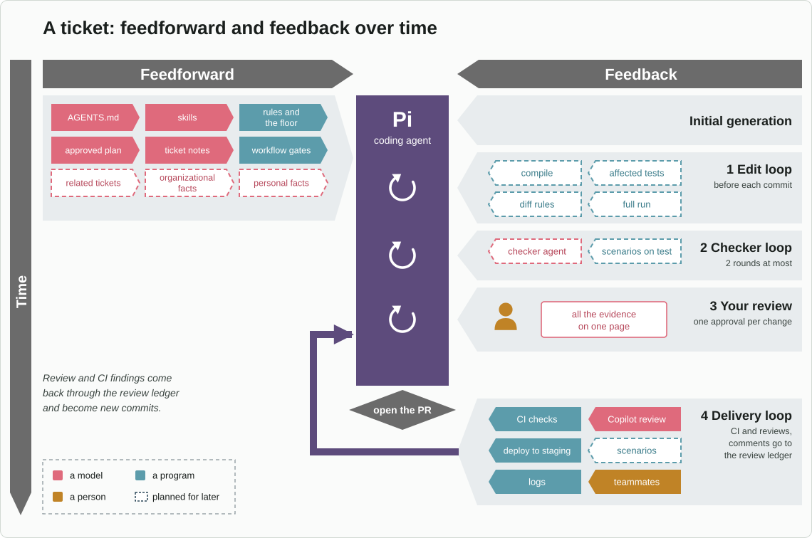
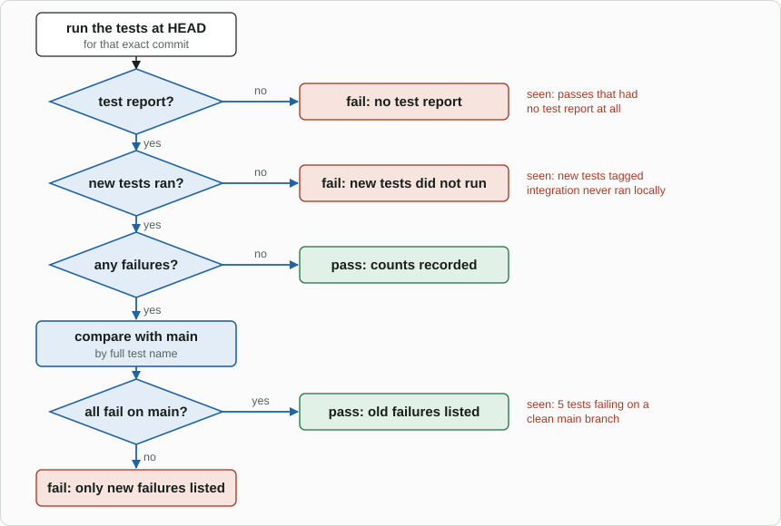

# Design

How `jig-workflow` is built, what it needs from other plugins, and how it is tested. Back to the
[jig-workflow overview](../README.md).

## Principles

1. **Evidence, not statements.** A condition holds because the plugin ran something, was shown something,
   or was told by a plugin it trusts, and saved the result against the commit or the plan it is about. The
   agent can ask; it cannot say "passed".
2. **A hold only ever tightens.** It goes through a gate in `jig-core`, which cannot loosen a decision, so a
   wrong workflow file makes work slower and never makes it less safe.
3. **Data, not code.** Workflows name stages and conditions from a fixed list. A custom check belongs in a
   repository's test command, where the sandbox runs it.
4. **Say what is missing, and how to fix it.** `status`, `advance` and every hold name the condition, the
   repository and the action that fixes it.
5. **Generic.** No ticket system, branch rule or company is built in; they arrive as files and settings.

## How it fits together

```text
/workflow start feature PROJ-123, or workflow start
  -> definition.ts / load.ts   the file is read and checked at session start; a broken one is reported
  -> store.ts                  <ticket folder>/PROJ-123/workflow.json: stage = first, notes hash saved
  -> runtime.ts                the ticket's workflow.json is registered with jig-core as a guarded path

the agent works; evidence arrives
  workflow test       -> tests.ts: command per repository -> jig().sandbox.run (or an approved exec)
                         -> result saved with the commit and whether the tree was clean
  workflow submit-plan-> plan.ts: check; jig-core shows plan.md; approved fingerprint saved
  jig-review:approved -> sources.ts: saved when it covers commits of a bound repository
  jig-ops:ci-finished -> sources.ts: saved when it names a bound repository's commit
  workflow scenario   -> plan.ts: result saved with evidence for the scenario's current text

workflow advance
  -> conditions.ts   each exit condition read from the file and the repositories as they are now
  -> all hold: the stage moves one step; else the missing ones are listed with the action that fixes each

any tool call
  -> jig-core: classify, decide
  -> gate.ts (registered gate): is the call held? is it one that always asks?
  -> jig-core: ask or deny, or let the call run
```

- **Conditions are read, not remembered.** `notes-updated` is the one that compares with a snapshot taken
  at the start of the stage; the others compare a saved result with the repository or plan as it is now.
- **The gate reads the same code as `advance`,** limited to the repository the call acts on, so a hold and
  an exit condition cannot disagree.
- **Remote facts are cached for holds.** `pull-request-open` and `checks-pass` need the network; `status`
  and `advance` read them fresh and save the reading, and the gate uses that reading while HEAD is
  unchanged.

## What it adds to other plugins

| Plugin | Addition | Why |
|---|---|---|
| `jig-core` | `gates.register(gate)`: a gate sees each call and can only ask or deny | Holds reach every tool, including Pi's `write` and `edit` |
| `jig-core` | `sandbox.canRun` and `sandbox.run(command, options)` | Tests run in the sandbox without this plugin knowing how it wraps |
| `jig-core` | The decision source `gate` on `jig:decision` and in the records | `/lens` can show how often a hold stopped work |
| `jig-sandbox` | `run` on its provider: the wrapping of `bash`, without the tool | The same rules, audit and explanations as the agent's shell |
| `jig-review` | `root`, the repository's absolute folder, on each entry of `repos` in `jig-review:approved` | The event named repositories by a path that is ambiguous outside Pi's folder |
| `jig-ops` | `jig-ops:ci-finished`, published when a CI watch ends | The watch's result names no commit, and `checks-pass` needs one |

Each is small, and each plugin's own documentation describes it.

## What the design settled

| Question | Decision | Why |
|---|---|---|
| Where do holds live? | A gate registered with `jig-core` | A hold must reach Pi's tools and everyone's, and `jig-core` already decides every call |
| Can a gate loosen? | No: it answers ask or deny, or nothing | Otherwise a plugin could undo the floor or your rules |
| How is a plan approved? | `submit-plan` is a call that always asks, and the preview is the plan | Approval inside the waiting call; the fingerprint ties it to the text |
| What if a rule allows `submit-plan`? | The gate asks anyway | A rule or a session answer must not stand in for reading the plan |
| Where do tests run? | In the sandbox; otherwise only after you approve the exact commands | An agent that can run anything on your account for its own checks is the thing the sandbox is for |
| What is a test result tied to? | The full HEAD and a clean tree | A pass on files that are not the commit proves nothing about the push |
| Is a dirty-tree pass kept? | Shown, never counted | It is useful to the agent and not evidence |
| Who writes `workflow.json`? | Only the plugin; guarded from file tools and the sandbox | An agent that could edit it could mark anything passed |
| Is the workflow copied into the state? | No, the name points at the file | Mending a file mid-ticket works; a missing one is reported |
| Which repository is a call in? | The one `jig-git` would resolve, or the path's | A hold in the wrong repository is no hold |
| Does a hold depend on the stage? | No, only on its condition | An edited plan must bring the holds back in any stage |
| One workflow per ticket? | Yes; switching archives the old state | Two sets of holds on one ticket cannot both be right |
| Can a workflow start by itself? | No; the session start line suggests one | Starting writes into the ticket folder |
| Is `back` free? | Yes, and it erases nothing | Going back to fix a plan must be easy; evidence is checked against what is now |
| How is review evidence trusted? | An event with full commits, for a bound repository, that covers commits | The agent cannot publish on the bus; the page's passkey is what proves you |
| `checks-pass` from where? | A CI watch for the commit, else `gh pr view`'s roll-up | The watch knows the required checks; the roll-up needs no setup |

## Where this comes from

The design follows the harness work of Böckeler: guides that steer the agent before it acts, and sensors
that check afterwards, with the hardest to sense, behaviour, covered by scenarios in the plan, the tests,
and you on an acceptance environment.



*What the harness regulates around a ticket, in [Böckeler's](https://martinfowler.com/articles/harness-engineering.html) layout. Behaviour stays highlighted because it is the hardest to sense: acceptance scenarios in the plan, the tests, and you in an acceptance environment together cover it.*



*A ticket over time. Guides go into Pi before it writes code, and feedback comes back at four points: the edit loop, the checker, your one approval, and after the pull request, where CI, reviews and teammates report through the review ledger. This plugin builds the edit loop and the stage gates; the rest is later.*

**Later,** and not built:
- **Check tiers:** compile, affected tests, diff rules and a full run, each failure compared with the main
  branch by full test name, so that a failure that already exists there never blocks a stage.
- **A checker agent** in a fresh context that reviews the change before anything is shared.
- **A review-comment ledger** for every comment, whatever its source.
- **One approval per change:** pushes need only passing tests, and you approve once with all the evidence.



*How the full run decides, once check tiers exist. Each question answers a failure seen in real sessions; a failure that already exists on the main branch never blocks a stage.*

## What building it changed

| The design said | What is so |
|---|---|
| The state file is guarded for the ticket the session works on | It is guarded the first time the session looks at a ticket that has one, whichever way the ticket became active |
| Remote conditions are read by `status` and `advance`, and cached for holds | The same: `status`, `advance` and the question to move on read the pull request fresh and save the reading for the holds |
| `bind` asks `jig-git` for a worktree | It runs the `git` tool through `ctx.executeTool`, so `jig-core` governs it as a nested call, and it reads the path from the tool's details |
| A plan that fails the check is refused | The check runs in the preview, so it is refused before anyone is asked, with every problem listed |
| `workflow test` asks when there is no sandbox | The gate asks, and the tool checks again when it runs: a sandbox that went away in between is a refusal, never an unasked run |
| A hold is scoped by the repository a call acts in | `write` and `edit` by their paths, `git` and `pr` by the repository they name (worked out as `jig-git` does), any other tool for the work as a whole; a repository that cannot be worked out is not held |

## Tests

- **Files:** every field and every rejection, with the path and key in the message; the examples in
  `examples/` load and match what the docs say.
- **Conditions:** every condition held, not held, and invalidated: a new commit, an edited plan, an edited
  scenario, a dirty tree, a pull request at an older head, an event for another repository.
- **The gate:** holds on `git commit`, `git push`, `write` and `edit` in bound repositories only, and
  not elsewhere; the calls that always ask, even with an allow rule and a session answer; the whole path in a
  real `jig-core`, where a gate cannot loosen anything.
- **Tests:** the command per repository, the build-file defaults, a fake sandbox provider for the sandboxed
  path, the unsandboxed ask, and one run in the real sandbox. That test needs `bwrap`, `socat`, `rg` and
  `python3`, skips with the reason when they are missing, and fails in CI, like `jig-sandbox`'s own.
- **State:** atomic writes, an invalid file, switching with its archive, the protected path.
- **The tool and the commands:** every action, with a fake `jig-core` and a fake Pi.

[Back to the overview](../README.md)
